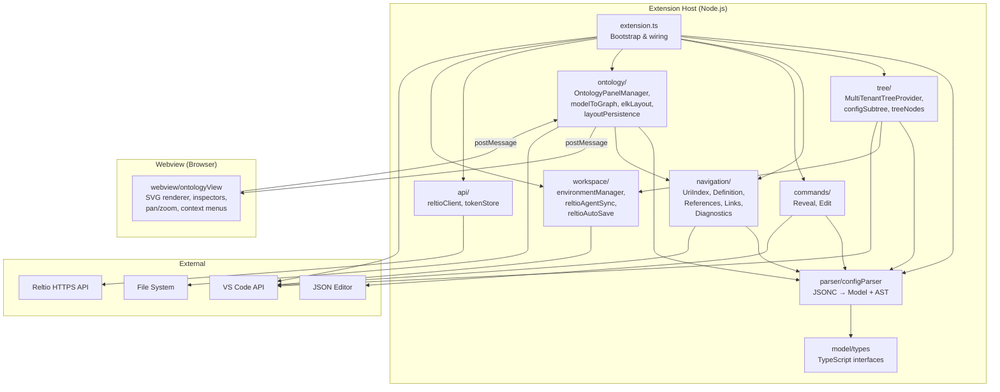

# Reltio Metadata Editor Architecture

> Audience: AI agents and human developers.

## Module Purpose

VS Code / Cursor extension for editing Reltio tenant metadata configurations (`*.reltio.json` files). Provides JSON schema validation, a hierarchical configuration tree view, Go-to-Definition / Find All References navigation, unresolved URI diagnostics, structural editing commands, and an interactive ontology graph preview.

This is a **single-module** project — not a multi-module monorepo. All source code lives under `src/` and is bundled into three separate artifacts: the extension host bundle and two webview client bundles (ontology graph, BPMN diagram).

## Domain Concepts

| Term | Definition |
|------|-----------|
| Reltio Business Model | The top-level JSON structure describing a Reltio tenant configuration — entity types, relation types, match rules, survivorship rules, cleanse rules, and related metadata. |
| Entity Type | A category of real-world object (e.g., Individual, Organization, Location) with attributes, match rules, and survivorship rules. |
| Relation Type | A named relationship between two entity types (e.g., "EmployedBy" linking Individual to Organization), with start/end type URIs. |
| Attribute | A data field on an entity or relation type. Can be simple (string, long, date), nested (contains sub-attributes), or reference (links to another entity type). |
| URI | A `configuration/...` path string that uniquely identifies a definition within the Reltio model (e.g., `configuration/entityTypes/Individual`). Used for cross-references throughout the JSON. |
| Consolidated Type | An entity type representing a merged "golden record" profile, as opposed to a source-specific profile. |
| Abstract Type | An entity type that serves as a parent for inheritance (`extendsFrom`) but is not instantiated directly. |
| UriIndex | The in-memory index mapping every `configuration/...` URI to its AST definition node and collecting all reference sites. Powers Go-to-Definition, Find References, diagnostics, and ontology navigation. |
| Virtual Definition | A synthetic URI created by `UriIndex` for attributes inherited through Reference attributes, allowing navigation to sub-attributes that are defined on a referenced entity type. |
| GraphModel | Intermediate data structure transforming the Reltio Business Model into nodes (entity types) and edges (inheritance, relationships, references) for ontology view rendering. |
| Layout Sidecar | A `*.reltio.layout.json` file stored alongside the configuration file, persisting user-arranged node positions for the ontology preview. |
| Git-sourced environment | An alternative to a live-tenant environment: a single environment node (named after the repository folder) holding one tenant per `BusinessConfig.json` discovered in a cloned or already-present git repository. The rows beneath it mirror the repository's directory layout (`repo / DP / dp_lif`) via inert `GitFolderNode` rows; a config's `tenantId` is its own folder name, qualified with the folder path only when two would otherwise collide. Wired in via `EnvironmentManager.setGitSources(...)`. Reuses the tenant-mode tree/navigation/ontology pipeline unchanged. See the **`git-repository-source`** OpenSpec change and its `design-amendment-multi-tenant.md`. |
| Workspace source | The `reltio.workspaceSource` context key (`'tenant' \| 'git' \| undefined`), independent of `reltio.uxState`, recording whether the workspace is connected to a live tenant or a git repository. Drives welcome-view button visibility and hides tenant-connectivity menu items in git mode. A workspace is one or the other, never both. |
| Environment | A Reltio host (e.g. `361.reltio.com`) represented as a `{host}.reltio.environment/` directory under `.reltio/` (preferred) or, for legacy workspaces, at the workspace root. Validated with `GET /reltio/status` before creation. |
| Tenant | A tenant ID under an environment, stored as `{tenantId}/` (the bare id; identity is in the folder's marker, not its name). The folder carries the **component tree** and is itself the **git repository root** when bound to a remote, so nothing git tracks contains the environment host or tenant ID. Holds `Business Config/BusinessConfig.json` (fetched L3 configuration) and `.reltio-ide/` (gitignored IDE state: drift baseline, ontology layout, history snapshots). |
| Token Store | In-memory map of environment name → Bearer token (and optional aliases). Never persisted; cleared on restart. For browser-OAuth environments it additionally holds the refresh token and access-token expiry alongside the in-memory access token. |
| Session Store | Thin wrapper over `vscode.SecretStorage` (OS keychain) that persists OAuth **refresh tokens** per environment so sessions survive a window reload. Access tokens are never written to disk. |
| OAuth credentials store | Per-environment OAuth **client ID**, **client secret**, and **SSO routing tenant ID** in `SecretStorage` (set via **Configure OAuth Client…**). The client pair can be shared across environments when only one pair is stored; the SSO routing tenant ID is always per-environment. Required for browser login and token refresh; never bundled in the extension. |
| L3 configuration | Tenant metadata returned by `GET /reltio/api/{tenantId}/configuration`, saved locally as `Business Config/BusinessConfig.json` (was `Business Config/BusinessConfig.json` before the `git-ready-tenant-folder-structure` change). |
| Configuration history (local) | Paginated revisions from `GET …/configuration/_history`, written as one JSON file per revision under `{tenant}/.reltio-ide/history/` (see **Configuration history** below). |
| UX state | A pure-function projection (`deriveUxState`) of the workspace's environments + tokens + OAuth credentials + opened-L3 files into a global state (`G_EMPTY` / `G_NEEDS_AUTH` / `G_NEEDS_TENANT` / `G_NEEDS_L3` / `G_READY`), per-environment state, and per-tenant state. Published as the `reltio.uxState` context key. Every "what's next" surface (walkthrough, viewsWelcome, tree descriptions, inline icons, status bar) reads from this single source. |
| Setup Wizard | Multi-step `QuickPick` chain (`src/ux/setupWizard.ts`) that takes a user from "no environment" to "L3 open in the editor" in one continuous flow. Reachable from the welcome view, the tree view title bar, the status bar, the Walkthrough, and the Command Palette. The existing single-input **Add Environment** command remains for now and will be retired in a later change. |

## Technology Stack

- **Language:** TypeScript 5.x, compiled and bundled with esbuild
- **Platform:** VS Code Extension API (engine `^1.85.0`)
- **Runtime:** Node.js (extension host) + browser (webview)
- **Bundler:** esbuild — three separate bundles (CJS for extension host, IIFE for each of the two webviews)
- **Key libraries:** `jsonc-parser` (AST parsing), `elkjs` (automatic graph layout)
- **Rendering:** Vanilla TypeScript + SVG (no React/framework in webview)
- **Packaging:** `@vscode/vsce` → `.vsix`

## Component Diagram



## Package Structure

| Directory | Purpose |
|-----------|---------|
| `src/model/` | Pure TypeScript interfaces mirroring the Reltio XSD/JSON schema — no runtime logic |
| `src/parser/` | Parses `*.reltio.json` text into a typed `ReltioBusinessModel` and a `jsonc-parser` AST; provides path-based navigation and safe structural edit helpers |
| `src/tree/` | `MultiTenantTreeProvider` (environments → tenants → History folder + L3 config sub-tree), `configSubtree` (shared section/entity/relation tree building, read-only `lifecycleActions` leaf), `treeNodes`, `multiTenantNodes` |
| `src/lca/` | LCA agent gates: working-directory + tenant context, L3 lookup, hook validation, Java package names, workflow confirmations, `lifecycleActions` diffs. Finds the connected configuration in the component tree (`Business Config/BusinessConfig.json`), a legacy `*.reltio.tenant/L3.reltio.json`, or a git marker |
| `src/api/` | Stateless Reltio REST helpers (`reltioClient`; `listTenants` reads `GET /reltio/enhancedTenants?showAll=true` and reduces each `TenantRecord` to its `tenantId`; the only call that omits the `xxx-client` header; `toHttpsBase()` is the single choke point every call passes through — it force-upgrades an explicit `http://` to `https://` and rejects any host outside the `reltio.trustedHostSuffixes` allowlist (default `reltio.com`) before a bearer token is attached, throwing `UntrustedHostError`), in-memory `TokenStore` (access token + optional refresh-token/expiry for OAuth sessions), `SessionStore` (refresh-token persistence via `vscode.SecretStorage`), `OAuthCredentialsStore` (per-environment client ID/secret in `SecretStorage`), **`oauthLogin`** (Authorization Code flow: local callback server on `http://localhost:8081`, browser-based `auth.reltio.com/oauth/sso`, code→token exchange, refresh-token rotation), `verifyMatches` (read-only `POST /reltio/api/{tenant}/entities/_verifyMatches` with candidate match groups; `ReltioApiError` carries the response body), and `formatJson` (pretty-print fetched L3 via `JSON.parse` / `JSON.stringify` — fast; preserves key / array order from the parsed document) |
| `src/ux/` | UX state derivation (`uxState.ts`), status bar item (`statusBar.ts`), Setup Wizard (`setupWizard.ts`), recents persistence (`recents.ts`), quick-switch command (`quickSwitch.ts`). The "what's next" guidance layer. |
| `src/util/` | Small shared helpers (e.g. **`jsonDeepEqual`** for JSON-parse result comparison) |
| `src/workspace/` | `EnvironmentManager` — creates `*.reltio.environment` at the **workspace root** (still scans legacy `.reltio/` dirs and never relocates one), manages tenant folders and resolves every tenant-local path through **`tenantFolderStructure.ts`** via `vscode.workspace.fs`; **`tenantFolderStructure.ts`** — the component-tree definition, docs-URL map, `materializeTenantTree`, and the only place legacy path literals are named; **`tenantGitBinding.ts`** — clone a chosen branch into a tenant folder, create an absent branch from the remote default, read `HEAD`, dirty-worktree check; **`layoutMigration.ts`** — detect/plan/back up/migrate/undo the legacy flat layout; `configurationHistory.ts` — snapshot file naming, read/write/clear under `history/`; **`reltioAgentSync.ts`** — materialize bundled skills, Velocity Packs, and the LCA knowledge base under `.reltio/reltio-agent/` (see D3b / `lca-assistant`), then run agent discovery and return a report of anything it could not install; **`agentSkillDiscovery.ts`** — install each bundled skill at `.claude/skills/<name>/` and the three missing-skill guides, tracking ownership in `.sync-state.json` (see *Agent skills in the user workspace*); **`matchVerification.ts`** — file bridge that answers an agent's `match-verification/request.json` by calling `_verifyMatches` with the user's session (see *Match verification bridge*); **`reltioAutoSave.ts`** — save dirty `*.reltio.json` on editor switch (and optionally on window blur) so disk matches agents and parse/index passes; **`gitConfigSource.ts`** — system-`git` shell-out helpers (detect existing repo/remote, clone, empty-folder check, path containment with a Windows case-insensitive drive fix) via `child_process.execFile`; **`l3Discovery.ts`** — depth-10 search for `BusinessConfig.json` (case-insensitive) plus conflict-aware environment/tenant naming; **`gitSourceMarker.ts`** — persists discovered L3 locations and tenant identity in `.reltio-config-source.json` (multi-source format, backward compatible, auto-gitignored along with `.reltio/`) |
| `src/navigation/` | Language feature providers: `UriIndex` (central URI → AST mapping), Go-to-Definition, Find References, Document Links, Diagnostics for unresolved URIs, **`uriCompletionProvider`** (Ctrl+Space URI + same-property value hints), **`uriPropertyScopes`** / **`samePropertyValues`** |
| `src/commands/` | `editCommands` (insert/delete/rename via `WorkspaceEdit`), `elementSkeletons` (default-name builders), `revealInsertion` (select inserted JSON), `revealCommand` |
| `src/ontology/` | Ontology preview: transforms model to graph, runs ELK layout, manages the webview panel lifecycle, persists layout positions. Also holds `inspectorHtml.ts` (pure, escaped HTML builders for the inspector popup) and `webviewMessageSafety.ts` (`message`-origin check, prototype-safe dynamic-key map) — kept outside `src/webview/` so `tsc`/`importDist` can test them directly, but imported by both the host and the webview bundle |
| `src/workflow/` | BPMN and Workflow Adapter logic, split by what each part needs so the testable majority needs nothing: **`workflowAdapterRegistry.ts`** — bundled environment → Adapter host table, consulted before probing or prompting (all lookups via `Map`, since the key is a workspace directory name); **`bpmnModel.ts`** — structural read of BPMN via bounded regexes (no XML parser anywhere in this repo, deliberately), blanking comments and the DI block with same-length space runs so reported character offsets still index the original text; **`bpmnDiagram.ts`** — pure, synchronous DI serializer, reader, and fixed-chain layout; **`bpmnLayout.ts`** — the `elkjs` half, async, so the draft-creation path never loads the layout engine; **`bpmnLabels.ts`** — pure label geometry and text, imported by both the layout and the webview bundle so the space reserved for a caption is the space it is drawn in; **`bpmnDiagnostics.ts`** — the `bpmn-rules.md` §10 checks as pure functions of the document text, returning offset-based findings; **`bpmnDiagnosticsManager.ts`** — the thin `vscode` adapter that turns those into squiggles in its own `reltio-bpmn` collection; **`bpmnPanel.ts`** — diagram webview panel lifecycle |
| `src/webview/` | Browser-side code for the two preview panels — `ontologyView.ts` (ontology graph) and `bpmnView.ts` (BPMN diagram): SVG rendering, pan/zoom/drag, inspectors, context menus. Bundled separately as IIFE, one bundle each. Both validate the origin of every incoming `postMessage` before trusting it (`window.origin`, captured at bootstrap, vs. `e.origin`). `bpmnView.css` is built on VS Code theme variables; `ontologyView.css` predates the light-theme work and renders dark regardless of theme |
| `schemas/` | JSON schema (`reltio-metadata.schema.json`) registered for `*.reltio.json` validation |
| `resources/` | Static assets (activity bar icon); **`resources/reltio-agent-assets.json`** (`skillsBundleVersion`, `velocityPacksBundleVersion`, **`lcaKnowledgeBaseBundleVersion`**); **`resources/velocity-packs/`** bundled Velocity Pack reference JSON + `manifest.json`; **`resources/lca-knowledge-base/`** LCA Assistant KB (7 docs + `manifest.json`, OpenSpec `lca-assistant` / RP-191824) |
| `skills/` | **`skills/reltio-default/*/`** default `SKILL.md` playbooks shipped in the VSIX (includes **`lca-assistant`**); optional **`skills/workspace/**`** team overrides (never overwritten by sync) |
| `samples/` | Example Reltio configuration files for testing |

### Velocity Pack reference assets

Industry **Velocity Pack** JSON (reference `BusinessConfig.json` files for agent grounding) lives under **`resources/velocity-packs/`** and ships in the **`.vsix`** as the **canonical** copy. **`manifest.json`** lists pack ids, `schemaVersion`, `vertical`, byte sizes, and paths. Maintainer notes: **`resources/velocity-packs/README.md`**.

Because the manifest records **byte sizes** and `validate-velocity-packs.cjs` asserts the declared total against the filesystem, these paths are pinned to `-text` in **`.gitattributes`**. Without it, Git's default `core.autocrlf=true` rewrites every LF on checkout and adds one byte per line — 15,431 bytes on `Account360` alone — so `test-skills-and-enablement-packs-library.cjs` failed on every Windows clone while passing in CI and on macOS. The manifest describes the canonical LF bytes; the attribute is what makes the working tree match them everywhere.

On workspace load, **`syncReltioAgentAssets`** (see `src/workspace/reltioAgentSync.ts`) **materializes** Velocity Packs into **`.reltio/reltio-agent/velocity-packs/`** when **`velocityPacksBundleVersion`** advances (or the mirror is missing), and the **LCA knowledge base** into **`.reltio/reltio-agent/lca-knowledge-base/`** when **`lcaKnowledgeBaseBundleVersion`** advances. Command **`reltio.resyncAgentAssets`** forces a re-copy of skills, packs, and LCA KB (still never touches `skills/workspace/**`). OpenSpec: **`skills-and-enablement-packs-library`** (D4b); **`lca-assistant`** (RP-191824).

### LCA Assistant (Cursor Agent)

- **Canonical skill:** `skills/reltio-default/lca-assistant/SKILL.md` — L3-first LCA advising, dual-workspace branching, opt-in Maven scaffold; uses the knowledge base with intent routing.
- **Bundled KB:** `resources/lca-knowledge-base/` (provenance in `PROVENANCE.md`; LCA content sign-off on RP-191824 before partner VSIX cut).
- **Partner invoke:** Sync installs the skill where agents find it (`reltio-lca-assistant` under `.claude/skills/` and the editor's own skills folder) and materializes the knowledge base at `.reltio/reltio-agent/lca-knowledge-base/`. The same playbook is also at `.reltio/reltio-agent/skills/default/lca-assistant/SKILL.md`. Sample prompts live in the skill and `openspec/changes/lca-assistant/demo-script.md`.
- The extension **does not** host an LLM; Cursor Agent (or compatible agents) reads the skill + KB.

### Cursor Agent assets in the user workspace

Layout under the **workspace root** after sync:

```text
.reltio/reltio-agent/                    # hidden (.reltio); extension-managed only
├── .sync-state.json                     # skillsBundleVersion + velocityPacksBundleVersion + lcaKnowledgeBaseBundleVersion + ownedAgentFiles
├── skills/default/                      # copies of skills/reltio-default — refreshed on skills bundle bump
├── velocity-packs/                      # mirror of packaged resources/velocity-packs — refreshed on pack bundle bump
├── lca-knowledge-base/                  # mirror of resources/lca-knowledge-base — refreshed on LCA KB bundle bump
└── match-verification/                  # request.json (agent) / result.json (extension) — see Match verification bridge

.claude/skills/reltio-<playbook>/        # discoverable skill copies, every editor (Claude Code reads only .claude/) — managed
.claude/rules/reltio-skills.md           # missing-skill guide, Claude Code — managed
.cursor/skills/reltio-<playbook>/        # second copy, Cursor only — managed
.cursor/rules/reltio-skills.mdc          # missing-skill guide, Cursor only (alwaysApply) — managed
.github/skills/reltio-<playbook>/        # second copy, VS Code only — managed
.github/instructions/reltio-skills.instructions.md  # missing-skill guide, VS Code only (applyTo all files) — managed

skills/workspace/                        # optional team overrides — never overwritten by extension sync
```

Precedence: **`skills/workspace/`** overrides the same logical playbook under **`.reltio/reltio-agent/skills/default/`**, and the discoverable copy under `.claude/skills/` is built with that precedence already applied. The thin stubs under this repository's own **`.cursor/skills/reltio-*`** are for contributors and never ship. LCA: [`openspec/changes/lca-assistant/design.md`](openspec/changes/lca-assistant/design.md).

### Agent skills in the user workspace

OpenSpec: **`match-rule-generation-skill`** (D4–D6, D8). After the `.reltio/reltio-agent/` copy, `syncAgentSkills` installs each bundled skill at **`.claude/skills/<name>/`**, where `<name>` is its frontmatter `name`, plus a second copy in the running editor's own folder: `.cursor/skills/` in Cursor, `.github/skills/` in VS Code, none in other editors (`detectHost` reads `vscode.env.uriScheme` / `appName`; `HOST_LAYOUTS` maps editor to folders). Claude Code reads only `.claude/`, which Copilot and Cursor also read today; the editor's own copy keeps discovery working if an editor stops reading `.claude/`. Opening the workspace in another editor removes the previous editor's managed copies, and any folder that removal leaves empty (never one that still holds the user's files, such as `.github/workflows/`). Skills whose `name` (lowercase letters, digits, single hyphens, ≤ 64 characters) or `description` (≤ 1024 characters) agents would reject are not installed.

A skill only loads when an agent judges it relevant, so it cannot report its own absence. Always-on **guides** do that, one for Claude Code plus one for the running editor: they list the installed skills and tell the agent to report a missing one, naming the resync command, instead of writing configuration from general knowledge. They are rewritten whenever their text differs.

**Ownership.** Every written path is recorded in `ownedAgentFiles`. A desired path already occupied by something the extension did not create is a **conflict**: untouched and reported. Owned paths dropped from the bundle are deleted; `reltio.installAgentSkills: false` deletes exactly the owned set. Each owned path is appended to the workspace `.gitignore` individually — never `.claude/` or `.cursor/` as a whole. Each managed skill folder is **converged** on its resolved content every sync: only differing files are written and stray files removed, so an unchanged workspace is not rewritten and a hand-edited managed copy is put back.

**Overrides.** `resolveSkills` applies the `skills/workspace/` precedence before installing. An override of a bundled playbook is laid over the default file by file (team files win; defaults it does not replace, such as `reference.md`, stay) and must keep the default's `name`. An override folder with no bundled counterpart is installed as a skill of its own. An override agents would reject is reported and **neither it nor the default is installed**, because serving the default would silently ignore the team. A watcher on `skills/workspace/**` re-runs the sync (500 ms debounce), so an edited override reaches agents without a reload.

**Reporting.** `runAgentAssetSync` in `extension.ts` turns conflicts, rejected skills and sync exceptions into a warning with **Resync Agent Assets**, and re-runs the sync when `reltio.installAgentSkills` changes.

### Match verification bridge

OpenSpec: **`match-rule-generation-skill`** (D1–D3). Lets an agent test a candidate match rule against the tenant without holding the session. The agent writes `.reltio/reltio-agent/match-verification/request.json`:

```json
{ "requestId": "…", "configFile": "dev/T1/Business Config/BusinessConfig.json",
  "matchGroups": [ … ], "pairs": [ { "label": "exact", "first": { … }, "second": { … } } ] }
```

`registerMatchVerificationBridge` watches that file (300 ms debounce, one retry on a partial write, requests handled one at a time) and writes `result.json` with the same `requestId`. **Identity is never taken from the request:** `configFile` is resolved inside the workspace, the extension rescans, and `EnvironmentManager.locFromPath` supplies environment and tenant, so the token can only reach its own environment. One `_verifyMatches` call per pair (≤ 10 pairs, ≤ 10 groups), stopping at the first failure; a 401 goes through `tryRefresh` and one retry.

| `status` | Meaning | Reasons / kinds |
|---|---|---|
| `verified` | every pair ran; per pair an `outcome` and a verdict per candidate rule | outcomes `auto-merge`, `suspect`, `matched`, `no-shared-token`, `no-match` |
| `not-verified` | live testing impossible; the agent may reason statically and must label it | `disabled`, `repository-mode`, `no-tenant`, `signed-out` |
| `failed` | it ran and failed; the agent must not insert the rule | `invalid-request`, `api-error` (with `httpStatus`, `responseBody`), `untrusted-host`, `network` |

`no-shared-token` means `matchedByDocuments` without `matched`: the rule logic holds but the records share no match token, so Reltio would never compare them. The "Reltio Match Verification" output channel logs each request and pair outcome, never the token. Full diagram and rules: [`openspec/changes/skills-and-enablement-packs-library/design.md`](openspec/changes/skills-and-enablement-packs-library/design.md) (§D3b, **§D4b**).


**Workflow playbooks.** Four of the bundled skills cover Reltio Workflow: `workflow-bpmn-authoring`, `workflow-jar-customization`, `workflow-repo-contribution` and `workflow-local-adapter-setup`. The first ships a `references/bpmn-rules.md` beside it — `copyDirectory()` in `reltioAgentSync.ts` recurses, so a playbook's subfolder materializes with it. That file carries what determinism needs and a 30-line playbook cannot hold: the exact namespace block, the out-of-the-box class allow-list, the schema ordering constraints, a validation checklist and a deny-list, each entry naming the error code or silent failure it prevents.

**Entry point and what the sync writes.** A fifth skill, `workflow-assistant`, is the single entry point for any workflow request: it names the playbooks to read, requires a `Skills read:` line and owns the shape of the reply. Nothing outside `.reltio/reltio-agent/` is written in a customer workspace (no `AGENTS.md`, `CLAUDE.md` or `.cursor/`); the user invokes the skill by name ("follow the Reltio workflow assistant"), the same convention as the LCA assistant. `syncReltioAgentAssets` is serialized (one in-flight run) and on every run removes only the files extension 1.0.24–1.0.26 wrote outside `.reltio/`, each recognised by its exact marker text, so a customer-owned `.cursor/skills/reltio-*` is never touched.

**Workflow trust boundary.** The workflow feature treats three things as untrusted input: clone URLs (no credentials in the URL, no leading `-`, passed after `--`; `redactUrl()` for anything shown), the committed `WorkflowRepo.reltio.json` (validated on read; only `https` links are opened; a username is never kept in it), and adapter responses (origin-only base URL via `toHttpsBase()`, `redirect: 'error'`, bodies bounded in time and size). A deploy acts on the process id **inside the XML** (`workflowDeployPlan.ts`), not on the file name, and a tenant's deployed list is fetched before any collision check. The workflow tree keeps "never fetched" (`undefined`) distinct from "fetched, empty", orders fetches per tenant across kinds, and populates the repository row from a local walk (`setWorkflowRepoDiscoveryHandler`) so it works after a reload. Spec: [`openspec/changes/workflow-review-fixes/`](openspec/changes/workflow-review-fixes/).

Raising `skillsBundleVersion` in `resources/reltio-agent-assets.json` is what delivers any skill change to an existing workspace — the sync gate is a string inequality against the user's `.sync-state.json`, so new files without a bump reach nobody. `scripts/test-workflow-skills-library.cjs` asserts the bump, house-style conformance, pointer parity, and that no internal-only content is shipped.
## Application Bootstrap

**Activation triggers** (union in `package.json`): `onLanguage:json`, `workspaceContains:**/*.reltio.environment`, `workspaceContains:**/*.reltio.json`, `onStartupFinished`, plus the implicit `onView:reltioConfigTree` that VS Code generates from the view contribution (so the tree works in an empty workspace once the Reltio view is opened). **`onStartupFinished` was added deliberately**, not as a redundant catch-all: the `workspaceContains:*` events above it depend on the host actually running its workspace-content scan and matching a real file, and that showed up as silently never firing in a real test — `.reltio/reltio-agent/` (the `syncReltioAgentAssets` target, see below) never materialized in a workspace that genuinely had `WorkflowAdapter.reltio.json` and `.reltio-environment.json` on disk, in a non-VS-Code host. `onStartupFinished` activates unconditionally shortly after window start regardless of workspace content or which sub-folder was opened as the root, so the Cursor Agent assets sync (and everything else gated on `activate()`) no longer depends on `workspaceContains` detection working correctly in every extension host. **A second, independent reason it must stay**: the first-run Setup Guide auto-open (`extension.ts`, the `guideAutoOpenedKey` check that calls `openSetupGuidePanel` when `environmentManager.scanEnvironments()` returns zero environments) only runs inside `activate()` — and a workspace with no Reltio markers at all is exactly the case every `workspaceContains:*` event above is guaranteed not to match. Without `onStartupFinished`, that workspace would never activate the extension, so the one onboarding path meant for a user with nothing set up yet would never fire — silently, since nothing throws and no test currently exercises a zero-marker workspace at activation time. Treat any future "this activation event looks removable" finding as needing both reasons re-checked, not just the Cursor Agent sync one above.

**`activate(context)` sequence:**

1. Instantiate `EnvironmentManager` (when a workspace folder exists), `TokenStore`, **`SessionStore`** (backed by `context.secrets` + `context.globalState`), `MultiTenantTreeProvider` (with `context.workspaceState` for history UI flags and compare-first URI), `UriIndex`, `ReltioDocumentLinkProvider`, `ReltioDefinitionProvider`, `ReltioReferenceProvider`, `DiagnosticsManager`, `OntologyPanelManager`
2. Create `TreeView` for `reltioConfigTree` view container
3. Register **`registerReltioAutoSave`** (`src/workspace/reltioAutoSave.ts`) — when enabled, saves dirty `*.reltio.json` on active-editor change and optionally when the window loses focus (`reltio.autoSaveOnEditorSwitch`, `reltio.autoSaveOnWindowBlur`)
4. **Fire-and-forget** `syncReltioAgentAssets(context)` (via `runAgentAssetSync`) — materialize bundled skills, Velocity Packs, and the LCA knowledge base under `.reltio/reltio-agent/` per `resources/reltio-agent-assets.json` vs `.sync-state.json`, then install the discoverable skill copies and guides; problems surface as a warning
5. Register language providers (links, definition, references) scoped to `**/*.reltio.json`
6. Register all commands (ontology, environment/tenant/L3 and configuration-history fetch, history compare, reveal, edit operations, **`reltio.resyncAgentAssets`**)
7. Set up debounced document change listener (300ms) — on `*.reltio.json` change: invalidate multi-tenant tree when `Business Config/BusinessConfig.json` or files under `history/` change, rebuild URI index
8. Set up active editor change listener — rebuild URI index when a different `*.reltio.json` becomes active
9. Initialize URI index from the current active editor if it matches `*.reltio.json`
10. **Fire-and-forget** OAuth session restore — for each scanned environment, call `sessionStore.loadRefreshToken(env)`; if a refresh token and OAuth client credentials are present, call `refreshTokens()` silently and on success store the rotated session via `tokenStore.setSession()` (and persist the new refresh token); if credentials are missing, delete the stale refresh token; on refresh failure delete the stored refresh token so the user is prompted to log in on next API call

**`rebuildUriIndex(doc)`** is the central refresh path: `parseDocument` → `uriIndex.build(model, ast)` → push index into all navigation providers → `diagnosticsManager.update`.

## Entry Points

**Language features** (registered for `**/*.reltio.json`, `**/L3.json`, and `**/BusinessConfig.json` — the latter two exist so a git-sourced repository's config still gets navigation, diagnostics, completion, and schema support even though it is not named `*.reltio.json`):

| Feature | Provider | Behavior |
|---------|----------|----------|
| JSON Validation | VS Code built-in | Schema from `schemas/reltio-metadata.schema.json` |
| Document Links | `ReltioDocumentLinkProvider` | Clickable links on URI reference strings |
| Go to Definition | `ReltioDefinitionProvider` | Ctrl/Cmd+click on `configuration/...` URI → jump to definition |
| Find References | `ReltioReferenceProvider` | Shift+F12 on URI → all usage sites |
| Diagnostics | `DiagnosticsManager` | Squiggles on unresolved `configuration/...` references |
| IntelliSense (URI values) | `ReltioUriCompletionProvider` | Suggests `configuration/...` definition URIs from **UriIndex** (scoped by property name via `uriPropertyScopes.ts`) plus **values already used for the same JSON property** elsewhere in the file; `"` and `/` triggers |

**Manual QA (URI completion, release gate):** Open a tenant `Business Config/BusinessConfig.json`; trigger Ctrl+Space inside string values for (1) a **reference attribute** (`referencedEntityTypeURI`, `relationshipTypeURI`, `referencedAttributeURIs`), (2) a **relation endpoint** (`startObject` / `endObject`) if present, (3) a nested **`uri`** under an attribute or source; confirm schema-driven **property-name** completion still appears when editing keys; confirm suggestions prefer indexed URIs and same-property reuse over random tokens (`editor.wordBasedSuggestions` defaults off for `[reltio.json]`).

**Commands** (registered in `package.json`):

| Command | Trigger | Action |
|---------|---------|--------|
| `reltio.showOntologyPreview` | Editor title bar / context menu | Open ontology graph preview |
| `reltio.revealInEditor` | Tree primary open / context menu | Open tenant `Business Config/BusinessConfig.json` if needed, navigate to JSON location |
| `reltio.showOntologyFromTree` | Configuration tree context menu | Open ontology preview for the tenant L3 document |
| `reltio.revealInTreeView` | Ontology view context menu | Reveal entity in tree |
| `reltio.addEntityType` | Tree / palette (`*.reltio.json`) | Insert **entity type skeleton** (`EntityType{n}`, `attributes: []`) — **no name wizard** |
| `reltio.addRelationType` | Tree / palette | Insert **relation type skeleton** (`RelationType{n}`, endpoint placeholders) |
| `reltio.insertGroupingType` / `insertGraphType` / `insertSource` / `insertHierarchyType` / `insertInteractionType` | Tree (tenant with L3 or matching section folder) | Bootstrap **grouping / graph / source / hierarchy / interaction type** skeleton (`BR-03` … `BR-05`, `SF-hierarchyTypes`, `SF-interactionTypes`) |
| `reltio.insertSimpleAttribute` | Tree (entity type, relation type, nested attribute, attributes folder) | **String** attribute skeleton (`ET-root` / `RT-root`) |
| `reltio.insertNestedAttribute` | *(same)* | **Nested** attribute skeleton (`attributes: []`) |
| `reltio.insertReferenceAttribute` | *(same)* | **Reference** attribute skeleton (empty URI placeholders) |
| `reltio.insertMatchGroup` | Tree (entity type row) | Append **match group** skeleton |
| `reltio.insertSurvivorshipGroup` | Tree (entity type or relation type row) | Append **survivorship group** skeleton |
| `reltio.insertCleanseConfig` | Tree (entity type row) | Attach **cleanse config** object if absent |
| `reltio.deleteNode` | Tree context menu | Remove node from JSON |
| `reltio.renameNode` | Tree context menu | Rename label and URI |
| `reltio.addEnvironment` | View title / welcome / palette | Validate host, create `*.reltio.environment` directory |
| `reltio.removeEnvironment` | Tree context (environment) | Delete environment directory tree |
| `reltio.configureOAuthClient` | Tree context (environment) | Prompt for OAuth client ID and secret; persist in `SecretStorage` for that environment (required before browser login). |
| `reltio.loginWithBrowser` | Tree context (environment) | OAuth Authorization Code flow using stored client credentials. Before opening the browser, POSTs to `/oauth/ssoCheck` with the per-environment SSO routing tenant ID to confirm external IdP is configured; if the response is `native`, login is blocked with a guided error pointing at **Provide Token**. On `sso`, generates a fresh CSRF `state` (16 bytes hex), opens the browser to `/oauth/sso`, captures the callback on `http://localhost:8081` (HTML success page: Reltio logo inlined as a data URI, **Login Successful!**, no links — the server closes after its single response), verifies `state` matches, exchanges the code for tokens, and shows an in-editor success notification. Errors: `PORT_BUSY`, `TIMEOUT`, `EXCHANGE_FAILED`, `NO_IDP_CONFIGURED`, `STATE_MISMATCH`, `SSO_CHECK_FAILED`. |
| `reltio.provideToken` / `reltio.useTokenFrom` | Tree context (environment) | Store or alias Bearer token in memory |
| `reltio.applyDefaultEnvironments` | Command Palette | Scaffold `reltio.defaultEnvironments` (host/tenant folders) and load bearers from optional workspace-relative `tokenFile` paths into memory (same as Provide Token). Never reads inline secrets from settings. Optional Fetch L3 when `reltio.fetchL3AfterApplyDefaults` is true; never auto-PUT. |
| `reltio.addTenant` | Tree context (authorized environment) | List tenants from API, create `*.reltio.tenant` directory and materialize the component tree |
| `reltio.connectTenantToGit` (**Connect to Git**) | Tree context (tenant), hidden in git-source mode | Prompt for a remote (remembered per workspace), then pick a branch from the remote's existing branches (`git ls-remote --heads`, no clone needed) or create one as free text. Binds the tenant folder as the repository root: **clone** when the folder is empty, **adopt in place** when it already holds a configuration. A branch absent on the remote is offered for creation from the default branch (never `--orphan`, so promotion branches share history) with the inherited configuration dropped. Writes the identity marker and `.gitignore`. Warns modally when another repository encloses the tenant. |
| `reltio.undoLayoutMigration` | Command Palette | Restore the legacy flat layout from `.reltio-ide-backup/` and clear the migration stamps |
| `reltio.removeTenant` | Tree context (tenant with or without L3) | Delete tenant directory |
| `reltio.copyTenantId` | Tree context (`reltio.tenant` / `reltio.tenant.l3`) | Copy tenant ID to the system clipboard |
| `reltio.fetchL3` | Tree context (tenant with L3) | Download L3 JSON via API, write `Business Config/BusinessConfig.json` and remote baseline. If local L3 has diverged from `.reltio-ide/BusinessConfig.baseline.json` (unpublished local edits), warns before overwriting — **Review changes** / **Fetch anyway** / **Cancel**. **Review changes** opens a diff (remote vs local), then offers **Fetch and overwrite** (replace local with remote) / **Apply my changes instead** (`pushLocalToTenant` — PUT local to the tenant, no further prompts) / **Cancel** |
| `reltio.applyL3Configuration` | Tree context (tenant with L3) | **PUT** local `Business Config/BusinessConfig.json` to tenant after GET-vs-baseline drift checks and confirmation/diff review (`putL3Configuration`); refreshes `.reltio-ide/BusinessConfig.baseline.json` from GET on success |
| `reltio.fetchConfigurationHistory` | Tree context (tenant with L3) | Clear `history/`, fetch first page (`max=10`), write snapshot files, expose History folder |
| `reltio.fetchMoreConfigurationHistory` | Tree context (History folder) | Fetch next page (`offset` = snapshot file count) |
| `reltio.historyCompareWithCurrent` | Tree context (any history snapshot) | `vscode.diff` snapshot vs tenant `Business Config/BusinessConfig.json` |
| `reltio.historyCompareWithPrevious` | Tree context (`reltio.history.snapshot.hasOlder` only) | `vscode.diff` with **older** snapshot on the left and **selected** on the right; neighbor is the next-older file in `listLocalHistorySnapshots` order (newest first). Chronologically oldest snapshot uses `reltio.history.snapshot` so this menu entry is hidden; if there is no older neighbor on disk, an informational message is shown instead of opening a diff. |
| `reltio.historySelectForCompare` / `reltio.historyCompareSelected` | Tree context (any history snapshot) | Store first URI in `workspaceState`, then open diff (same tenant only) |
| `reltio.refreshEnvironment` | Tree context (environment) | Rescan workspace tree |
| `reltio.resyncAgentAssets` | Command palette | Force re-copy of bundled skills, Velocity Packs, and the LCA knowledge base into `.reltio/reltio-agent/`, and of the discoverable copies under `.claude/skills/` |
| `reltio.launchSetupWizard` | Welcome view, view title bar, status bar, walkthrough, Command Palette | Multi-step QuickPick chain: host → sign-in method → auth sub-flow → first tenant → confirm. Persists results and opens L3 on finish. |
| `reltio.openSetupGuide` | Welcome view, Command Palette | Opens the in-product Setup Guide webview (`resources/setupGuide.json`). Six steps: tenant connect → auth → pick tenant → model → apply, plus **Connect a Git repository instead**. Markdown twin: `docs/setup-guide-content.md`. The `reltio.gettingStarted` walkthrough mirrors those six steps (`featuredFor` includes `*.reltio.json`, `BusinessConfig.json`, `L3.json`). |
| `reltio.signInEnvironment` | Inline tree icon on `E_NO_AUTH` env rows | Smart helper: QuickPick to choose browser-OAuth vs token, then runs the matching command. |
| `reltio.signInToFirstEnvironment` | Walkthrough step 2, status bar (when `G_NEEDS_AUTH`) | Same as above but picks the first unauthed env automatically. |
| `reltio.openL3` | Inline tree icon on tenants with L3, single-click on tenant row when `reltio.tenantSingleClickOpen` is true | Opens the tenant's `Business Config/BusinessConfig.json` in the editor. |
| `reltio.quickSwitchEnvironment` | Command Palette | QuickPick across configured envs; focuses the tree and opens L3 if exactly one tenant has it. |
| `reltio.fetchConfigFromGit` | Welcome view ("Connect your Repository"), Command Palette | Detects an already-cloned repo (`.git` + remote) and skips to discovery, or prompts for a remote URL and clones it into the open (empty) folder via system `git`. Discovers `BusinessConfig.json` files (auto-select, quick-pick, or file-dialog fallback), calls `EnvironmentManager.setGitSources(...)`, registers a sentinel auth token, and flips `reltio.workspaceSource` to `'git'`. Guarded against concurrent invocation and against a workspace that already has a connected tenant. |
| `reltio.removeGitSource` | Tree context (environment, git mode only) + view title | **"Remove Repository"** — deletes the workspace folder contents and clears all git sources, the sentinel token, and `reltio.workspaceSource`, returning to the welcome screen. State is cleared even if deletion partially fails. |
| `reltio.removeGitTenant` | Tree context (tenant, git mode only) | **"Remove Config"** — drops a single config from the git-sourced tree by filtering it out of the marker file, then re-derives naming for the rest and re-asserts the sentinel token, since all configs in a repository share one environment name. Clearing the last config clears state but keeps files on disk. |
| `reltio.addFileAsTenant` | Explorer context (`.json` files, git mode only) | **"Add Config"** — validates the JSON, detects same-folder name conflicts, re-derives naming for all configs, and updates the marker. Allows adopting non-standard filenames that auto-discovery skips. |

Create actions use the **context menu** only (`3_insert@*` groups — no `inline` tree buttons).

**Webview** — ontology graph preview panel, one per document URI.

## Dependencies and Integrations

| Dependency | Role |
|-----------|------|
| `vscode` | Extension host API — editors, tree views, webview panels, commands, diagnostics, language features |
| `jsonc-parser` | Parses JSON-with-comments into both a typed JS object and a structural AST; used for navigation, editing, and URI indexing |
| `elkjs` | Eclipse Layout Kernel — computes layered graph layout with orthogonal edges for both previews: top-to-bottom for the ontology (a hierarchy), left-to-right for a BPMN diagram (a sequence — laid out downward it looks wrong to anyone who works with them) |
| `@vscode/vsce` | Dev dependency — packages the extension into a distributable `.vsix` |
| `esbuild` | Dev dependency — bundles TypeScript into three runtime artifacts (extension host, ontology webview, BPMN webview) |
| System `git` executable | Not an npm dependency — resolved at runtime from the `git.path` VS Code setting or `PATH` and shelled out to via `child_process.execFile` for the git-repository-source flow (detect/clone). Auth is delegated entirely to the system git installation and its credential helper; the extension has no OAuth code of its own for this. |

**Network:** `reltioClient` calls Reltio HTTPS endpoints (`/reltio/status`, `/reltio/enhancedTenants?showAll=true`, `/reltio/api/{tenant}/configuration` **GET**/**PUT**, `/reltio/api/{tenant}/configuration/_history`, `/reltio/api/{tenant}/entities/_verifyMatches` **POST**) when the user validates an environment, lists tenants, fetches L3, **applies** local configuration to the tenant, or fetches configuration history, and when an agent asks the match verification bridge to test a candidate rule (read-only; never creates, merges or changes entities). Every call resolves its base URL through `toHttpsBase()`, which rejects a host outside the `reltio.trustedHostSuffixes` allowlist (default `reltio.com`; `scope: application`, so only a User/Machine setting can extend it — never a workspace's own `.vscode/settings.json`) before attaching a bearer token — an environment folder named after an untrusted host (e.g. discovered from an untrusted workspace) cannot exfiltrate a token this way, and cannot extend its own trust boundary either. **`oauthLogin`** additionally calls `https://auth.reltio.com/oauth/sso` (browser redirect) and `https://auth.reltio.com/oauth/token` (code exchange + refresh-token rotation) using per-environment client credentials from `OAuthCredentialsStore`. Access tokens are never written to disk; refresh tokens and OAuth client secrets are stored in OS-keychain `SecretStorage` only. All other features operate on local workspace files.

**Silent 401 refresh:** API calls that return 401 go through `tryRefresh(env)` in `extension.ts` — looks up the stored refresh token via `TokenStore.getRefreshToken`, loads OAuth client credentials from `OAuthCredentialsStore`, calls `refreshTokens()` from `oauthLogin.ts`, and on success rotates the session via `TokenStore.setSession` + `SessionStore.saveRefreshToken`. Concurrent 401s share a single in-flight refresh via `TokenStore.refreshInFlight` so only one network round-trip happens. If credentials are missing or refresh fails, the session and stored refresh token are cleared and the user sees "Session expired — log in again".

**Browser OAuth setup:** See `docs/browser-oauth-login.md`.

### Tenant folder files (`{tenantId}/`)

The tenant folder is the **git repository root** once bound to a remote. Everything git tracks lives in the component tree; everything the IDE maintains for itself lives in the gitignored `.reltio-ide/`. That split is what lets two tenants clone one repository on different branches and diff cleanly.

- **`WorkflowAdapter.reltio.json`** — the tenant's Workflow Adapter base URL. A URL and a `version` field; never a token. Tracked at the tenant root, not gitignored: it is shared, non-secret configuration, not IDE-owned working state, so every teammate who clones the tenant's repository gets the correct Adapter URL automatically. When absent, `resolveAndSaveAdapterUrl()` in `extension.ts` resolves it in one fixed order: **bundled registry → naming-convention probe → ask the user**. A registry hit is instant, needs no token, and survives an unreachable environment, none of which is true of a probe — and the probe's convention (`{label}-workflow`) is wrong for the nine shared adapters and the six irregular hosts, which is most of Reltio's estate. An environment the source table answers two ways returns `ambiguous` and shows a QuickPick, and if that is dismissed the flow goes to the prompt and **not** to the probe: both candidate hosts are real and answer, so a probe there does not fail, it silently confirms an arbitrary one. A registry host is bare and still passes `toHttpsBase()`, so bundling a hostname grants it no trust.
- **`WorkflowRepo.reltio.json`** — the tenant's binding to its Reltio-provisioned Custom Workflow Repository (Part 3): `{ version, repoUrl, relativePath }`, managed by `src/workspace/workflowRepoConfig.ts`. Same shape and same rationale as `WorkflowAdapter.reltio.json` — tracked at the tenant root, never gitignored, since a repository URL is shared, non-secret configuration. One repository per tenant: `saveWorkflowRepoConfig()` always overwrites rather than appending, so there is no multi-source marker complexity to maintain (unlike `git-repository-source`, which had to grow one after real-world use).
- **`Workflows/BPMN/`** — local BPMN process definitions ("Drafts"), `{processId}.bpmn20.xml`, each with a `{processId}.bpmn20.baseline.xml` beside it once it has been fetched from the tenant. One rule separates the two kinds of file: a BPMN **with** a baseline is a downloaded deployment, and one **without** was never on the tenant, so it is a draft. Deploying a draft gives it a baseline and it stops being one. Comparison and baseline rules live in `src/workspace/workflowBpmnFiles.ts` — which also owns the process-id pattern, since every local BPMN is discovered by parsing its filename and the two rules have to agree; `src/workspace/workflowDrafts.ts` holds the draft-only XML generation and re-exports those rules. `EnvironmentManager` supplies the URIs only. Moved here from a flat `{tenantId}/workflows/` in Part 3, with no migration step and none needed: Part 2 had not shipped to any customer when this moved, so there was no on-disk data at the old path to preserve.
- **`Workflows/Custom Workflows/`** — the clone target for a customer's own, Reltio-provisioned Custom Workflow Repository (Part 3), reusing the component-tree leaf `git-ready-tenant-folder-structure` had already reserved. Everything about it lives in `src/workspace/workflowRepo*.ts`:
  - **Discovery is content-driven, never filename-driven** (`workflowRepoDiscovery.ts`'s `discoverBpmnFiles()`): a file is a tracked BPMN only if it parses via `extractProcessModel()` to a non-empty `<process id>` — a customer's own repository is written by their own tooling under their own convention, unlike Drafts, where this extension controls the filename.
  - **The sync badge is byte-exact** (`workflowRepoSync.ts`'s `compareBpmnContent()`), confirmed empirically against a real tenant: a BPMN deployed through the Adapter and refetched came back byte-identical. Kept behind one function so a future dialect that reformats is a one-function change. Recomputed after Fetch Workflows / Deploy and by the manual **Refresh Sync Status** command — never by a filesystem watcher on the repository folder.
  - **The row expands into groups by file kind, not into folders** — `BPMN (n)` (`WorkflowRepoBpmnFileNode`, each with its badge and **Deploy**/**Preview Diagram**), `Java Classes (n)` and `Java Tests (n)` (`WorkflowRepoJavaFileNode`), all under a shared `WorkflowRepoGroupNode`. An empty group is omitted rather than shown as `(0)`. This reverses `custom-workflow-repository`'s original D7 ("VS Code's Explorer already shows the folder"), which answered a different question than the one that matters: which specific file is out of sync.
  - **Why groups and not a mirror of the repository's folders** (`workflow-repo-contents-and-agent-access` D1, which rejected the mirror rather than deferring it — do not re-propose it without reading that first): the provisioned template buries its deepest class nine levels down, so a faithful mirror needs eight expansions plus a folder-compaction scheme to be usable; the BPMN-to-Java relationship is many-to-many, so no nesting is both faithful to disk and useful; and a mirror has to decide what to do about `target/` after a build, which means either a `.gitignore` parser or four noisy generated subtrees. Grouping by kind sidesteps all three.
  - **Java discovery is path-driven, the exact opposite of BPMN's rule** (`workflowRepoJavaDiscovery.ts`'s `discoverJavaSources()`): matched on the Maven `src/{main,test}/java` convention, with identity — package, class, owning module — read from the path and the file never parsed, because Java and Maven both require the directory to encode the package. The load-bearing consequence is that the glob *cannot* match `target/`, so build output is excluded by construction rather than by a filter. Its depth limit is deliberately 16 rather than `discoverBpmnFiles()`'s 10: the provisioned template's deepest class already sits at exactly 10, so sharing that constant would have silently dropped classes for any customer with one more package level.
  - **A Java row is read-only and makes no reference claims.** Its only command is `vscode.open`; editing and saving go through the ordinary editor. It deliberately does not say which BPMN files reference the class — `bpmnModel.ts` extracts `activiti:class` only, so shared helpers called from other Java, delegates bound via `activiti:delegateExpression` or a listener, and every test class would all read as "referenced by nothing", which is a confident wrong answer.
  - **Two watchers, because the repository is not under `Workflows/BPMN/`.** The Drafts watcher's glob never matched the clone, so a repository edit left the badge asserting `synced` against changed content. A second watcher on `**/Workflows/Custom Workflows/**/*.xml` *invalidates* the cached badge without recomputing it — recomputation fetches deployed XML per file, which is not a per-save call. It must glob `*.xml` (filenames carry no identity), so `pom.xml` matches too; the handler therefore filters against the files `discoverBpmnFiles()` actually found, so saving a `pom.xml` cannot blank out the badges.
  - **Deploy is direct, with no promote-to-Draft copy**: `reltio.deployWorkflow` tries `resolveDraftContext()` first (unchanged, filename-based, cheapest), then falls back to `resolveRepoBpmnContext()` for a file under a connected repository. The repository file stays exactly where it is; the deployed result is an ordinary `ProcessDefinitionNode`, linked back to its source only via the sync badge.
  - **The nested-repository hazard, and why the fix is silent:** cloning into `Workflows/Custom Workflows/` makes it a second git repository whenever the tenant folder is *also* bound via `reltio.connectTenantToGit` — a repository nested inside a repository, which without intervention would make the outer repository record the inner `.git` as a gitlink rather than the files themselves, so cloning the outer repository elsewhere would silently produce an empty folder where the customer's workflow code should be. `workflowRepoGitignore.ts`'s `reconcileWorkflowRepoGitignore()` fixes this by re-deriving the answer from scratch on activation and on every tree refresh — checking whether the tenant folder currently has an outer `.git` *and* a connected repository, and adding the `.gitignore` entry if so — rather than reacting to either connect command, so it is correct regardless of which order the two bindings happened in, and correct even if one of them happened in a previous session or on a teammate's machine. The fix is deliberately silent (no notification either way): by the time it runs, the hazard is already fully resolved, and a notification for a problem that never became visible would only be confusing.

```text
{tenantId}/                        <- git root (.git, .gitignore)
├── .reltio-config-source.json     (gitignored) environment host + tenant id
├── .reltio-ide/                   (gitignored) IDE working state
│   ├── BusinessConfig.baseline.json
│   ├── BusinessConfig.layout.json
│   └── history/
├── Business Config/
│   └── BusinessConfig.json        <- tracked: the tenant metadata
├── RDM/README.md
├── Workflows/
│   ├── BPMN/README.md
│   └── Custom Workflows/README.md
└── LifeCycle Actions/README.md    generated projects live under LifeCycle Actions/<type>-<hook>-<name>-lca/
```

- **`Business Config/BusinessConfig.json`** — active tenant metadata being edited. The only component the IDE currently fetches or applies.
- **`.reltio-ide/BusinessConfig.baseline.json`** — copy of the remote configuration **as of the last successful Fetch Configuration**; used with **Apply Configuration to Tenant** to detect server-side drift before **PUT**. Kept out of the tracked tree so a drift baseline never shows up in a pull request.
- **The other component folders** (`RDM`, `Workflows/BPMN`, `Workflows/Custom Workflows`, `LifeCycle Actions`) are structural placeholders for components the IDE does not yet fetch or apply. Each carries a generated `README.md` naming the expected files and linking to `docs.reltio.com`, because git does not track empty directories. An existing `README.md` is never overwritten — except by **Connect Custom Workflow Repository** itself, which clears its own generated placeholder (`workflowRepoConnect.ts`'s `clearGeneratedReadmeBeforeClone()`, matched on the same marker text) before cloning, since `git clone` refuses a non-empty directory and `isFolderEmpty()` does not special-case `README.md` the way it does `.reltio`/OS artifacts. Generated LCA Maven projects are written under `LifeCycle Actions/<type>-<hook>-<name>-lca/`.
- **Retired folders.** Earlier builds materialized further components (`Data Validation Functions`, `Metadata Permissions`, `User Management/*`, `Data Loader`, `Reltio Integration Hub`, `DTSS`, `Connectors`, `User Interface`, `Custom Code/*`, `Physical Configuration`, and a short `LCA` folder). They are listed in **`RETIRED_COMPONENT_FOLDERS`** and removed during the activation migration, but only when a folder holds nothing except a README this extension generated, matched on content. One user file, or a README the user rewrote, keeps the folder. `Physical Configuration` stays retired until that component is implemented.
- The tree definition, the documentation URL map, and `materializeTenantTree` live in **`src/workspace/tenantFolderStructure.ts`**, which is the single place any of these paths are named.

## Configuration history (`.reltio-ide/history/`)

- **Directory:** `{environment}/{tenantId}/.reltio-ide/history/`
- **Files:** `L3-<sanitizedUpdatedBy>---<timestamp>.reltio.json` — each file contains **only** the `configuration` object from the API row, pretty-printed with tabs (see `writeHistorySnapshot` in `src/workspace/configurationHistory.ts`).
- **First fetch:** clears all files in `history/`, then requests `offset=0`, `max=10`, writes one file per row. **Fetch more:** does not clear; uses `offset` = number of valid snapshot files already on disk.
- **Tree visibility:** History appears when there are snapshot files **or** when the in-memory `historyExposedThisSession` set contains `reltio.history.exposed::<environment>::<tenant>` (added after a successful first fetch, so an empty API page still shows the folder rather than making the command look like it did nothing). That marker is deliberately **session-scoped, not `workspaceState`**: persisting it made the courtesy permanent — an empty History folder reappeared on every later window and on reconnecting the same tenant, with nothing in it and no way to dismiss it, which users reported as History appearing "by default" on connect. `removeTenant` and `removeEnvironment` clear their keys, so a re-added tenant does not inherit the decision. Snapshot nodes use `reltio.history.snapshot` for the chronologically oldest file on disk and `reltio.history.snapshot.hasOlder` when a strictly older snapshot exists in the same folder (drives **Compare with previous** in the context menu). Two-snapshot compare stores the first URI under `reltio.history.compareA.v1` until **Compare selected** runs.

### Manual verification (configuration history)

Use a workspace with a tenant that has `Business Config/BusinessConfig.json` and a valid token: run **Fetch configuration history**, confirm `history/` files and tree nodes; reload the window and confirm History still lists disk snapshots; run **Fetch more** and confirm additional files; open a snapshot; **Compare with current**; **Compare with previous snapshot** on a non-oldest row (diff vs immediate older neighbor) and confirm the oldest row has no **Compare with previous** menu entry and shows the informational message if the command is run anyway; **Select for compare** then **Compare selected** on another snapshot of the same tenant; provoke **401** (bad token) and confirm the token is cleared and the user is prompted like other API flows.

### Manual verification (fetch configuration overwrite guard)

With a tenant that already has `Business Config/BusinessConfig.json` and a valid token: run **Fetch Configuration** once to establish a baseline, then edit `Business Config/BusinessConfig.json` locally (e.g. add an entity type) and run **Fetch Configuration** again — confirm a modal warning appears with **Review changes** / **Fetch anyway** / **Cancel**; **Cancel** must leave the local file untouched; **Fetch anyway** must overwrite immediately. **Review changes** must open a diff (remote vs local) and then show a second, non-modal prompt with **Fetch and overwrite** / **Apply my changes instead** / **Cancel**: **Cancel** (or dismissing it) must leave both the local file and the tenant untouched; **Fetch and overwrite** must replace the local file with the remote (left) version, same as **Fetch anyway**; **Apply my changes instead** must PUT the local file to the tenant with no further confirmation dialogs, refresh `.reltio-ide/BusinessConfig.baseline.json` on success, and leave the local file itself unchanged. Run **Fetch Configuration** again with no local edits since the last fetch and confirm it proceeds silently (no prompt). Delete `.reltio-ide/BusinessConfig.baseline.json` and run **Fetch Configuration** on a tenant with local edits — confirm the prompt still appears (missing baseline is treated as unverified, not safe).

### Manual verification (apply configuration)

With a valid token: run **Fetch Configuration** and confirm `.reltio-ide/BusinessConfig.baseline.json` appears next to `Business Config/BusinessConfig.json`. Edit `Business Config/BusinessConfig.json` locally; run **Apply Configuration to Tenant** — when remote matches baseline, confirm **Yes** / **View changes** / **Cancel** and that **View changes** opens a diff (temp remote vs local). Optionally change the tenant on the server elsewhere, fetch in another session or skip fetch to simulate drift — **Apply** must require **Review changes** vs **Skip**. After a successful apply, confirm baseline refreshes (or run **Fetch Configuration** if the refresh warning appeared). Provoke **401** on apply and confirm token clearing matches other API flows. If **PUT** fails with **400**, confirm the error notification includes the API response body when present.

## Folder naming and identity

Folder names carry no identity. `dev.reltio.com.reltio.environment/GrmSwAZFRAeVy1K.reltio.tenant/`
is now `dev/GrmSwAZFRAeVy1K/`. What the extension needs lives in two gitignored markers:

| Marker | Location | Holds |
|---|---|---|
| `.reltio-environment.json` | environment folder | the full host, e.g. `dev.reltio.com` |
| `.reltio-config-source.json` | tenant folder | environment host + tenant id |

**The host stays the environment's identity everywhere in code.** Only the directory name is
shortened to the first DNS label, because every API call needs the host. Where two hosts want the
same label (`dev.reltio.com` and `dev.uk.reltio.com`), the first keeps it and the second falls
back to its full host. Tenant folders are the bare tenant id: unique and stable by definition, and
unaffected by a tenant rename in Reltio.

The environment marker sits *above* any tenant git root, so it is never committed. The tenant
marker is inside the repository and therefore gitignored, and it is written at **tenant creation**
rather than at git-bind time: with the suffixes gone it is the only thing identifying the folder.

Two consequences for the code:

- **Discovery is marker-based** (`collectEnvironmentDirs`, `scanTenants`), and still accepts
  legacy `*.reltio.environment` / `*.reltio.tenant` folders so an un-renamed workspace works.
- **Paths can no longer be parsed back into an identity.** `EnvironmentManager` keeps two maps
  rebuilt on every scan: `tenantLocations` ((env, tenant) -> actual directory, because a legacy
  folder is not named after its id) and `tenantPathIndex` (the reverse, so `getParent` and
  first-open tracking stay synchronous). `locFromPath` is the public lookup.

## A Git repository above the tenant folders

Each tenant folder is meant to be its own repository. One rooted above them breaks the layout in
one of two ways, both observed:

| Situation | What happens |
|---|---|
| Tenants not bound | The outer repository tracks `{env}/{tenantId}/Business Config/BusinessConfig.json`, putting environment and tenant back into every path. Branches can no longer be compared, which is the whole point of the layout. |
| A tenant bound | The outer repository stores the tenant as a **gitlink** (mode `160000`): a commit pointer whose files it does not hold. Cloning it yields an empty tenant folder. |

The extension **cannot prevent this**. `git init` and Source Control's **Initialize Repository**
belong to the built-in git extension, and an extension cannot intercept another extension's
command. So the handling is to make it harmless and to report it:

- **`ensureWorkspaceGitignored`** writes a workspace-root `.gitignore` covering `.reltio/`,
  `.reltio-ide/`, `.reltio-ide-backup/` and both marker filenames. Without it an outer repository
  commits the synced Velocity Packs (megabytes) and the environment marker, which sits above the
  tenant and so escapes the tenant's own ignore file.
- Environment folders are **deliberately not ignored**. One repository for the whole workspace is
  a legitimate choice; it just should not happen by accident.
- **`findEnclosingGitRepository`** (`gitConfigSource.ts`) walks up to the filesystem root and
  reports the nearest repository, including one at the start directory itself.
- Activation warns once per workspace (dismissal in `workspaceState`), offering **Ignore Tenant
  Folders** (adds each environment folder to the outer `.gitignore`), **Show Details** (a
  generated markdown explainer) and **Don't Show Again**.
- **Connect to Git** warns modally before creating a repository inside another one.

## Legacy layout migration

Workspaces created before the `git-ready-tenant-folder-structure` change hold a flat tenant folder. On activation, in **tenant mode only** and off the critical path, `layoutMigration.ts` moves each such tenant onto the component tree without prompting, so a team never ends up running two layouts side by side.

| From (tenant root) | To (tenant root) |
|---|---|
| `L3.reltio.json` | `Business Config/BusinessConfig.json` |
| `{host}.reltio.environment/` | `{short label}/` (e.g. `dev.reltio.com` -> `dev`) |
| `{tenantId}.reltio.tenant/` | `{tenantId}/` |
| `L3.remote-baseline.reltio.json` | `.reltio-ide/BusinessConfig.baseline.json` |
| `L3.reltio.layout.json` | `.reltio-ide/BusinessConfig.layout.json` |
| `history/` | `.reltio-ide/history/` |

Because it is unprompted, the safety is in the procedure:

- **Backup first**, to `.reltio-ide-backup/{env}/{tenant}/` at the workspace root (outside the tenant folder so a later commit cannot capture it, inside the workspace so the user can find it). Added to the workspace-root `.gitignore` and retained after success.
- **Stamp on full success only** (`reltio.layoutMigrated::{env}::{tenant}` in `workspaceState`), so an interrupted run is retried on the next activation rather than left half-done and marked complete.
- **Refuses a dirty worktree.** Moving tracked files under uncommitted work would bury it in a large rename diff. The tenant is skipped, reported, and retried once the worktree is clean.
- **Reports afterwards** with one non-blocking notification per workspace and a **Show details** action listing every move.
- **`reltio.undoLayoutMigration`** restores from the backup and clears the stamps.

Files are moved, not copied, so content is preserved byte-for-byte and no stale duplicate is left behind.

### Manual verification (layout migration)

Open a pre-upgrade workspace with two legacy tenants: confirm both migrate automatically, the summary notification appears, **Show details** lists each move, and the backup exists at `.reltio-ide-backup/`. Reload the window and confirm nothing re-migrates. Dirty the worktree of a legacy tenant that is a git repository, reload, and confirm it is skipped with a message and migrates on the next activation once clean. Run **Undo Layout Migration** and confirm the legacy layout is restored and the tenants are reconsidered on the next activation.

## Data Architecture

Beyond the file system, the extension keeps **tokens only in memory** (`TokenStore`). It reads `*.reltio.json` files (including `Business Config/BusinessConfig.json` under tenant folders), maintains `UriIndex`, and writes the ontology layout sidecar to `.reltio-ide/BusinessConfig.layout.json` inside the tenant folder (a git-sourced repository that carries the component tree gets the same treatment; one with an arbitrary layout keeps its sidecar beside the config, as before). `WorkflowAdapter.reltio.json` (managed by `src/workspace/workflowAdapterConfig.ts`; a URL only, never a token) is tracked at the tenant root instead of `.reltio-ide/`, since it is shared, non-secret configuration rather than IDE-owned working state.

All sidecars share the same pattern: a `version` field, `try/catch` on read → `undefined` on any error, and no secrets ever written.

**In-memory / workspace data flow:**

```
{env}/{tenant}/Business Config/BusinessConfig.json
(environment dirs live at the workspace root; legacy ones under .reltio/ are still scanned)
    ↓ parseDocument()
ReltioBusinessModel + AST
    ↓                          ↓
MultiTenantTreeProvider   UriIndex.build()
(configSubtree sections)         ↓
    ↓                    Definition/Reference/Diagnostics
TreeView UI
    ↓
buildGraphModel() … → Webview SVG (same as before)
```

## Configuration

**Extension settings** (via `contributes.configuration` in `package.json`):

| Setting | Type | Default | Effect |
|---------|------|---------|--------|
| `reltio.unresolvedUriSeverity` | `warning` \| `error` \| `information` \| `hint` \| `off` | `warning` | Controls diagnostic severity for unresolved `configuration/...` URI references |
| `reltio.autoSaveOnEditorSwitch` | `boolean` | `true` | Save dirty `*.reltio.json` when the active editor changes (another tab, tree, or panel) so disk stays aligned with agents and the extension |
| `reltio.autoSaveOnWindowBlur` | `boolean` | `false` | When the VS Code window loses focus, save all dirty `*.reltio.json` documents |
| `reltio.uxMode` | `default` \| `classic` | `default` | Toggles the redesigned setup experience. `classic` restores the pre-redesign behavior. |
| `reltio.tenantSingleClickOpen` | `boolean` | `true` | Single-click on a tenant row triggers the next action (fetch L3 if missing, open L3 if present). |
| `reltio.defaultEnvironments` | `array` of `{ host, tenantId, tokenFile? }` | `[]` | Seed environments/tenants from settings. `tokenFile` is a **workspace-relative path** to a local JSON file with `access_token` — never embed tokens or OAuth secrets in settings. Absolute/escaping paths and unsafe host/tenant path segments are rejected. Conflicting `tokenFile`s for the same host are rejected. Unique `tokenFile` paths are loaded once at activation (and on file change / 401), independent of apply-on-activate. |
| `reltio.applyDefaultsOnActivate` | `boolean` | `false` | Scaffold folders (and optionally fetch L3) from `defaultEnvironments` once on activation when a folder is open and the workspace is trusted. Token load from `tokenFile` still happens at startup when settings list a path. |
| `reltio.fetchL3AfterApplyDefaults` | `boolean` | `false` | After apply defaults, fetch L3 when a token is loaded. Does not PUT/apply config to the tenant. |
| `reltio.installAgentSkills` | `boolean` | `true` | Install the bundled skills at `.claude/skills/reltio-*` plus the editor's own folder (`.cursor/skills` or `.github/skills`), with the matching missing-skill guides; `false` removes exactly the files the extension created. Applied on change. |
| `reltio.enableMatchVerification` | `boolean` | `true` | Answer agents' match-verification requests through `_verifyMatches` with the signed-in session. `false` answers every request `not-verified` / `disabled` without calling the tenant. |

**Build configuration:**

| File | Purpose |
|------|---------|
| `tsconfig.json` | TypeScript compiler options (type checking; esbuild handles actual bundling) |
| `package.json` scripts | esbuild invocations for extension host and webview bundles |
| `.vscodeignore` | Whitelist of files included in the `.vsix` package |

**VS Code workspace configuration:**

| File | Purpose |
|------|---------|
| `.vscode/launch.json` | F5 debug launch configuration for Extension Development Host |
| `.vscode/tasks.json` | Build tasks |
| `.vscode/settings.json` | Workspace-level editor settings |

## Deployment

This is a VS Code extension, packaged as a `.vsix` file.

**Build output:**

| Artifact | Size | Content |
|----------|------|---------|
| `dist/extension.js` | ~3.3 MB | Bundled extension host (includes `jsonc-parser` + `elkjs`) |
| `dist/webview.js` | ~33 KB | Bundled ontology webview client |
| `dist/webview.css` | ~5 KB | Ontology webview styles |
| `dist/bpmnView.js` | ~12 KB | Bundled BPMN diagram webview client |
| `dist/bpmnView.css` | ~3 KB | BPMN diagram webview styles |

**Package command:** `npm run package` → `target/reltio-metadata-editor-<version>.vsix` (~600 KB compressed)

**Installation:**
- VS Code: `code --install-extension target/*.vsix`
- Cursor: `cursor --install-extension target/*.vsix`
- Or via Extensions UI → "Install from VSIX..."

## Logging and Monitoring

No structured logging framework. The extension uses:
- VS Code's built-in diagnostic system (`DiagnosticCollection`) for reporting issues to the user
- Standard `console` for development debugging (stripped in production use)

No metrics, health checks, or telemetry are collected.

## Concurrency Model

**Extension host (Node.js, single-threaded):**
- All providers run on the VS Code extension host thread
- Document change processing is debounced at 300ms to avoid redundant re-parsing
- `UriIndex.build()` is synchronous — rebuilds the full index on each document change
- ELK layout (`computeLayout`) is async but runs on the same thread via `elkjs` bundled (non-worker) mode

**Webview (browser, single-threaded):**
- SVG rendering, event handling, and inspector logic run on the webview's single JS thread
- Communication with extension host is asynchronous via `postMessage` / `onDidReceiveMessage`
- The webview's `message` listener validates `e.origin` against its own `window.origin` (captured at bootstrap) before reading `e.data` — VS Code assigns each webview panel a random `vscode-webview://<uuid>` origin, so there is nothing to hardcode; see `isTrustedMessageOrigin()` in `src/ontology/webviewMessageSafety.ts`

No shared mutable state between extension host and webview — they communicate exclusively through message passing.

## Key Design Patterns

**AST-based navigation over regex:** All navigation (Go-to-Definition, Reveal in Editor, ontology view navigation) uses the `jsonc-parser` AST and `UriIndex` code model. No regex-based text search for URI resolution — this ensures correct navigation even when the same URI appears in multiple JSON sections.

**Two-pass URI indexing with virtual definitions:** `UriIndex.build()` first indexes all real URI definitions and references, then synthesizes virtual definitions for attributes inherited through Reference attributes. This allows Go-to-Definition on deeply nested reference attribute paths.

**Dual-bundle architecture:** The extension is split into two esbuild bundles with no shared runtime code. The extension host bundle (CJS, Node.js) handles all VS Code API interaction. The webview bundle (IIFE, browser) handles all rendering. They communicate only via typed `postMessage` calls.

**Sidecar layout persistence:** Ontology node positions are stored in a companion `*.reltio.layout.json` file rather than in VS Code workspace state. This makes layouts portable across machines and visible in the file system.

**Model-first graph construction:** The ontology view builds a `GraphModel` from the parsed `ReltioBusinessModel` — not from the raw JSON. This ensures the graph always reflects the same semantic model used by the tree view and navigation providers.

**Read XML with bounded regexes; never add a parser:** `src/workflow/bpmnModel.ts` extracts process structure with local regular expressions, as `workflowBpmnFiles.ts` already did for the DI block. The reason is not performance — every mainstream Node XML parser resolves external entities by default or has done, and this path handles customer BPMN content, so reading four attributes off each element is not worth an XXE surface. The trade is that the module assumes well-formed input, which holds because every consumer treats a thin or empty model as "nothing to draw" rather than an error: a malformed file degrades to an empty preview. Two techniques make it safe in practice — ignored regions (comments, the existing diagram block) are blanked with **same-length** space runs rather than deleted, so every reported character offset still indexes the original text; and no `g`-flagged pattern is a module constant, because a shared global regex carries `lastIndex` between calls and silently starts scanning mid-document.

**Diagram interchange is part of authoring, not decoration:** the Activiti engine runs a definition with no `<bpmndi:BPMNDiagram>` section perfectly well, and every *viewer* reads nothing else — so a BPMN shipped without one opens as a blank canvas in the Reltio console, in Camunda Modeler and in this extension's own preview. `buildBpmnSkeleton` therefore emits DI, and `rewriteProcessIdentity` retargets `<bpmndi:BPMNPlane bpmnElement>` when duplicating: a plane left naming an id no longer in the document is the worst available failure, since the file stays valid, deploys, runs, and renders nothing with no error anywhere. Generation is split across two files by what it needs — `bpmnDiagram.ts` is pure and synchronous so the skeleton stays synchronous and the draft path never loads `elkjs`, while `bpmnLayout.ts` holds the async engine for arbitrary documents. The viewer prefers positions already in the file so a fetched definition is shown as its author arranged it, and falls back to computing them only when the file's own DI does not cover **every** element (`isCompleteFor`) — partial DI is worse than none, because the shapes that are present look correct and the missing ones read as elements absent from the workflow.

**One module decides how wide a label is:** the BPMN layout runs in the extension host, before a webview exists, so it cannot measure text against a DOM; the renderer runs in the webview and draws it. While each side had its own idea of a caption's size the layout reserved 36 units for a start event and the renderer filled 130, which is the entire mechanism behind text drawn across shapes. `src/workflow/bpmnLabels.ts` is therefore shared by both: it returns the **final display strings**, already wrapped and ellipsised, so there is no width to re-derive and get out of step. Widths are estimated from an average glyph advance and err high — over-reserving leaves a gap, under-reserving overlaps, and a measured width would mean posting the diagram, measuring in the DOM, sending widths back and laying out twice per open. Two corollaries, both learned from diagrams that still rendered badly after the shared module existed. A caption is sized against **the geometry it will occupy, not a constant**: `edgeLabel()` returns the text and its anchor from one call, because the answer to "how wide may this be" is "as wide as the run you are about to centre it on", and a fixed 150-unit cap put a 148-unit condition two thirds of the way across the gateway at one end and the task at the other. And a connector is captioned with its **flow `name`** in preference to its `conditionExpression`, as every BPMN tool does — `Approve` fits on a seventy-unit run and `${quorumDecision == 'Approve'}` cannot; the expression is the fallback for an unnamed branch, ellipsised to fit with the full text on the group's `<title>`. Neither of these is reachable from the layout engine, which is the point: **every definition fetched from a tenant ships its own DI and never runs ELK at all**, so any fix made only in `bpmnLayout.ts` leaves the common case untouched. Two consequences worth knowing: the box `layoutProcess` hands ELK is *not* the shape (it is inflated to cover the caption, symmetrically in height, and only the true BPMN size is written to the DI — every reader draws the size it finds), and the terminal waypoints are snapped from the box boundary back onto the shape, which is safe only because `elk.direction: RIGHT` puts every port on an east or west face and therefore makes both terminal segments level.

**Rules as pure functions, diagnostics as a thin adapter:** `src/workflow/bpmnDiagnostics.ts` implements the `bpmn-rules.md` §10 checklist with no `vscode` import, returning `{ offset, length, message, severity, code }`; `bpmnDiagnosticsManager.ts` converts those to `vscode.Diagnostic`s in its own `reltio-bpmn` collection. The split is what makes every rule assertable in a CLI unit test against a string fixture. Three properties are deliberate rather than incidental. Findings carry a **range over the offending element's opening tag** — a diagnostic on line 1 of a 90-line file makes the reader search, so `bpmnModel.ts` records a `length` on every element for this. Severity is decided **per rule**: `error` where Activiti or a viewer will definitely reject or mishandle the file, `warning` where the rule can legitimately be broken by something the checker cannot see. Two rules sit on the warning side for different reasons, and both were errors first. An `activiti:class` outside §5 is fine when a customer ships their own JAR, which this check cannot inspect. A missing gateway `default` is *unreachable* when the conditions are exhaustive — a required two-value enum, which is the shape every Reltio review workflow uses — and Activiti accepts the deploy either way, so an error fired on correct definitions already running on the tenant. That is the failure mode to guard against in both directions: a rule that squiggles working files is one users switch the panel off over, which costs them the rules that were right. And `reltio.bpmnDiagnosticsSeverity` moves only the warnings: a setting able to demote a deploy that is going to fail is not a preference. Nothing here touches the network, so a squiggle never depends on a tenant being reachable — which is also why §10.7 and §10.10 remain the agent's to answer.

**Hand-built multipart bodies, not `FormData`:** `buildMultipartBody()` in `src/api/workflowAdapterClient.ts` assembles the deploy request body byte by byte and takes its boundary as a parameter. `FormData` generates its boundary internally at random, which makes the bytes that go on the wire unassertable; `tsconfig.json` also sets `lib: ["ES2022"]` with no `"DOM"`, so `FormData`/`Blob` availability is not something to depend on. Lengths are UTF-8 byte lengths — a BPMN carrying an accented process name is the case where byte and string length diverge, and getting it wrong malforms the request in a way the server reports unhelpfully. `scripts/test-workflow-authoring.cjs` pins the exact layout with a non-ASCII fixture.

**Untrusted text never reaches a header:** the multipart builder refuses a field name or filename containing a quote or a line break, so a value that reached it from outside could not inject additional multipart headers. Process ids are already validated upstream; this is depth, not the primary control.

**Escape at the boundary, verify with a hostile fixture:** Every dynamic string the ontology webview places into `innerHTML` (entity/attribute/relation names and URIs) is escaped in `src/ontology/inspectorHtml.ts` before it reaches a template string — never at the point of insertion. `scripts/test-ontology-webview-hardening.cjs` runs a deliberately hostile `.reltio.json`-shaped fixture (names containing ``, `<script>`, quotes) through the real `buildGraphModel()` → `inspectorHtml.ts` pipeline and asserts the output never contains an unescaped tag or attribute, rather than relying on a one-time manual read-through.

## Common Modification Recipes

### Add a new language feature provider

1. Create a new provider class in `src/navigation/` implementing the appropriate VS Code provider interface (e.g., `HoverProvider`, `CodeActionProvider`)
2. The provider should accept `UriIndex` via a `setIndex()` method, following the pattern in `definitionProvider.ts` and `referenceProvider.ts`
3. Register the provider in `src/extension.ts` within `activate()`, scoped to `RELTIO_SELECTOR`
4. Wire the index update in `rebuildUriIndex()` so the provider receives the latest index on document change

**Anti-pattern:** Don't parse the document inside the provider — always use the shared `UriIndex` that is kept in sync by `rebuildUriIndex()`.

**Example:** `src/navigation/definitionProvider.ts`

### Add a new tree section

For a **config-model section** (entity types, relation types, sources, etc.) — sections that live inside `L3.reltio.json`:
1. Define the new section's structure in `src/model/types.ts` if not already present
2. Add tree node creation logic in `src/tree/configSubtree.ts` (section list and child dispatch) — follow existing patterns for entity types, relation types, or folders
3. Assign a `ConfigNodeType` and `contextValue` in `src/tree/treeNodes.ts` for menu targeting
4. If the section needs commands, register them in `src/extension.ts` and add `when` clauses in `package.json` `contributes.menus`

For a **service-level section** (a distinct backend service, not part of the L3 config) — e.g., the Workflow Inspector:
1. Add new node classes in a *separate* file (e.g., `src/tree/workflowNodes.ts`), not inside `treeNodes.ts`, so the `ConfigNodeType` union stays clean.
2. Add the new node types to `MultiTenantTreeElement` in `multiTenantTreeProvider.ts` and add `getChildren` / `getParent` branches.
3. For lazy-loaded data, use an in-memory cache map on `MultiTenantTreeProvider` keyed by `"${env}/${tenantId}"` and expose a `markXxxLoaded()` method the command handler calls after a successful fetch.
4. For persisted settings (service URL, etc.), use a sidecar JSON file in the tenant directory — see `src/workspace/workflowAdapterConfig.ts` for the pattern.

**Anti-pattern:** Don't add context menu items without a `when` clause — they'll appear on all tree items.

**Example:** Entity types section in `configSubtree.ts`; Workflow Inspector in `workflowNodes.ts` + `multiTenantTreeProvider.ts`

### Add a new Reltio API endpoint

For a **platform API** (all calls go to the same Reltio environment URL as `listTenants`, `fetchL3Configuration`, etc.):
1. Add an async function in `src/api/reltioClient.ts` using `fetch` + `fetchWithTimeout`, building URLs with `toHttpsBase(baseUrl)`.
2. Map non-200 responses to `ReltioApiError`; treat 401 as unauthorized for token clearing in `extension.ts`.
3. Call the new function from the appropriate command handler in `src/extension.ts` (environment vs tenant context).
4. Document the endpoint in the OpenSpec / internal API reference if the contract is non-trivial.

For a **separate service API** (different base URL, e.g. the Workflow Adapter):
1. Create a new client module (e.g., `src/api/workflowAdapterClient.ts`).
2. **Always call `toHttpsBase(serviceUrl)` before attaching any bearer token** — this ensures the host allowlist (`reltio.trustedHostSuffixes`) is applied, `http://` is upgraded to `https://`, and no credential can be sent to an untrusted host.
3. Use `fetchWithTimeout` (imported from `reltioClient.ts`) rather than raw `fetch` to get the 15-second abort safety net.
4. Wrap network-level failures in a domain-specific error class (e.g., `WorkflowConnectionError`) so the command handler can distinguish "wrong URL" from "wrong credentials" and offer the right recovery action.
5. `toHttpsBase` and `fetchWithTimeout` are exported from `reltioClient.ts` precisely for this pattern.

For a **mutating call to a separate service** (e.g. deploying a BPMN):

1. Follow the separate-service rules above, then take the payload as a **string, not a `vscode.Uri`**. The test harness's `vscode` stub returns an empty `Uint8Array` from `workspace.fs.readFile`, so anything that reads a file is untestable by construction — keep the file read in the command handler (`vscode.workspace.openTextDocument(uri).getText()`) and leave the API function a pure string-to-request transform.
2. Save a dirty editor before reading it, via `ensureDocumentSaved()` in `extension.ts`, so a command can never act on stale disk contents.
3. Give the call its own timeout constant; a write that the server parses is not a read.
4. **Re-fetch from the server afterwards** rather than patching the local cache — the server assigns ids, versions and timestamps, and may re-serialise the payload.
5. Do not pre-gate the action on a role. The extension never decodes the JWT and has no roles endpoint, so a user's Reltio roles are unknowable client-side; a disabled-looking menu item would be a lie. Handle the 403 reactively and name the role in the message.

**Example:** `deployProcessDefinition()` in `workflowAdapterClient.ts`, called from `reltio.deployWorkflow`.

6. **Declare the command in `package.json` *and* register it in `src/`.** These are two separate edits and nothing ties them together: a command with a `contributes.commands` entry and a menu entry but no `registerCommand` call looks complete in review and in every structural test, then fails at click time with "command not found". `scripts/test-workflow-authoring.cjs` asserts every declared command is registered.

### Add a new webview message type

1. Add the message handler in `src/ontology/ontologyPanel.ts` inside `panel.webview.onDidReceiveMessage`
2. Post the message from the webview in `src/webview/ontologyView.ts` using `vscode.postMessage({ type: '...', ... })`
3. If the message requires URI navigation, use `UriIndex.getDefinitionNode()` — never regex search

**Decision:** Host → webview messages carry data (graph, positions). Webview → host messages carry user actions (save, navigate, reveal).

**Anti-pattern:** Don't access VS Code APIs from the webview — all VS Code interaction must go through `postMessage` to the host. Don't interpolate a new field from `e.data` into HTML without escaping it via `src/ontology/inspectorHtml.ts`'s `escapeHtml()`, and don't use a message-derived string as a dynamic object key without `createKeyedMap()` (`src/ontology/webviewMessageSafety.ts`).

**Example:** `savePositions` message flow in `ontologyPanel.ts` and `ontologyView.ts`

### Add a new command

1. Declare the command in `package.json` under `contributes.commands`
2. Add menu placement in `contributes.menus` with appropriate `when` clause
3. Register the handler in `src/extension.ts` using `vscode.commands.registerCommand`
4. If the command modifies JSON, use `WorkspaceEdit` with AST-based range calculations from `src/parser/configParser.ts`

**Anti-pattern:** Don't use string manipulation to edit JSON — always use `jsonc-parser` AST for range calculation to handle commas, nesting, and formatting correctly.

**Example:** `src/commands/editCommands.ts` — `addEntityType()`

## Unit tests (OpenSpec-aligned)

CLI unit tests validate behavior introduced by each OpenSpec change. They use **Option A**: `node:assert`, `scripts/test-<change-name>.cjs`, and `npm run compile` (`tsc` → per-file `dist/`). The shipped VSIX still uses the **esbuild** bundle (`dist/extension.js`); tests import compiled modules from `dist/` separately.

**Run tests:**

```bash
npm test    # compile + scripts/run-unit-tests.cjs (code-model first)
```

**Pipeline order:** `npm test` → `npm run build` → `npm run package`

| Tier | CI | Meaning |
|------|-----|---------|
| A | Must pass | Pure logic and fixtures (`assert`) |
| B | Must pass | Structural smoke (schema JSON, manifest, packaging files) |
| C | Documented only | Manual QA — listed in each test script header and the change `design.md` **Test plan** |

**Canonical L3 fixture:** [`samples/first-test.json`](samples/first-test.json) — shared input for navigation, config tree, ontology, autocomplete, schema-alignment, and apply tests. Load via `scripts/lib/load-canonical-fixture.cjs`.

**Code-model gate:** `test-code-model-and-schema.cjs` runs **first**. It is the only test that reads hardcoded expectations from [`samples/code-model-manifest.json`](samples/code-model-manifest.json).

**No expectation files elsewhere:** Navigation, autocomplete, config-tree, apply, and similar tests MUST NOT use committed oracle/spot JSON or hardcoded URI lists. They derive assertions at runtime from the parsed model + AST + `UriIndex` (self-oracle helpers under `scripts/lib/`).

**Updating test fixtures:** When `first-test.json` or other registered sample JSON changes, update `samples/code-model-manifest.json` only. Model-derived tests pick up new content automatically.

**Layout:**

- `scripts/run-unit-tests.cjs` — explicit registry; `test-code-model-and-schema.cjs` first, then alphabetical
- `scripts/test-<openspec-change-slug>.cjs` — one per shippable OpenSpec change (umbrella `reltio-metadata-editor` uses child scripts)
- `scripts/lib/` — shared helpers (`import-dist`, `load-canonical-fixture`, `walk-configuration-uris`, `assert-navigation`, `assert-tree-walk`, `assert-completion-scopes`, `vscode-stub`, `memory-fs` (in-memory `workspace.fs` for folder, gitignore and sync code), `validate-velocity-packs`)
- `samples/code-model-manifest.json` — sole committed expectations file for parse/structure counts

**Rule for every new OpenSpec change** that adds or modifies runtime behavior:

1. Add or update `scripts/test-<change-name>.cjs` and register it in `scripts/run-unit-tests.cjs`.
2. Add a **Test plan** subsection to the change `design.md` with **Automated** (Tier A/B) and **Manual QA** (Tier C) tables.
3. Add at least one task in the change `tasks.md` to implement or update the test script.
4. Do **not** add expectation/oracle JSON for model-derived tests — extend the canonical fixture and/or code-model manifest instead.

## Architectural Opportunities

**VS Code integration tests:** `@vscode/test-electron` could complement CLI unit tests for command handlers and tree context menus; not in scope for the current harness.

**Activation scope:** The extension still activates on generic `onLanguage:json` in addition to Reltio-specific `workspaceContains` patterns and the view-contribution `onView:reltioConfigTree`. Dropping `onLanguage:json` would reduce load for unrelated JSON at the cost of discoverability when users only open raw JSON.

**ELK worker mode:** `elkjs` is loaded in bundled (synchronous) mode. For very large configurations, the layout computation could block the extension host thread. Using the web worker version of `elkjs` would move layout to a background thread.
