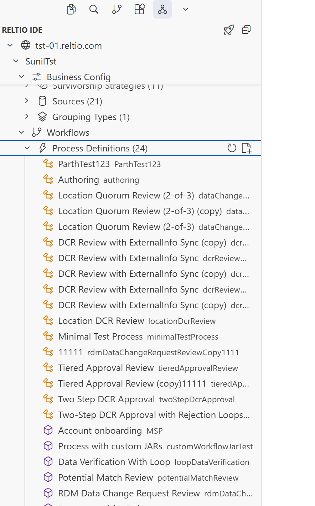
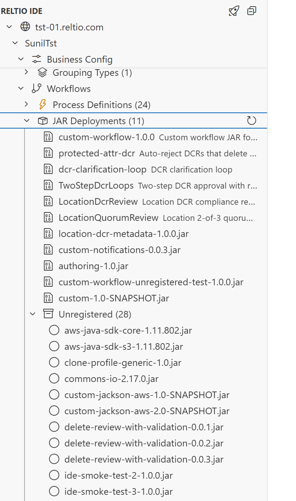
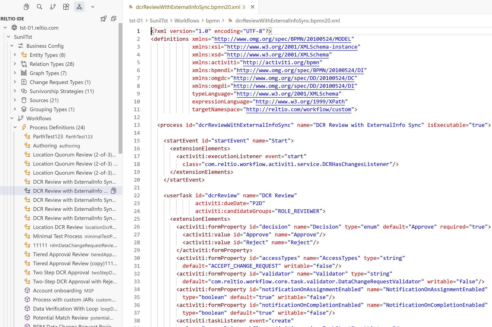
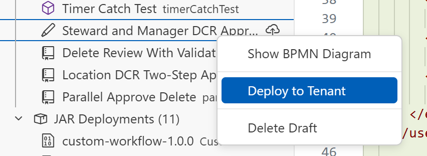
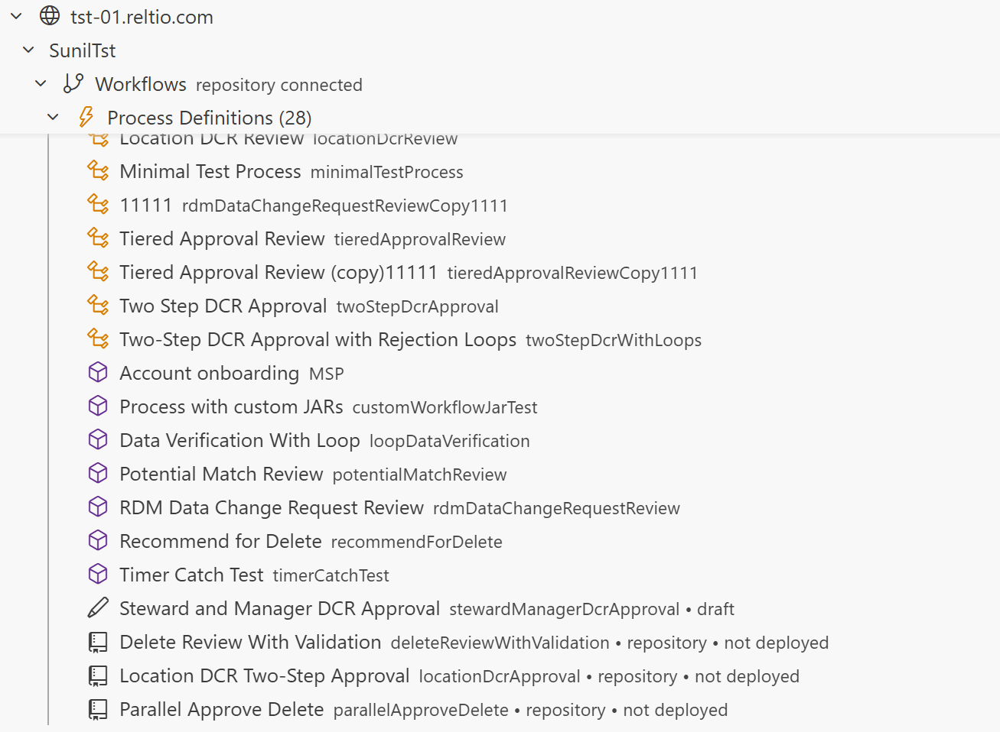
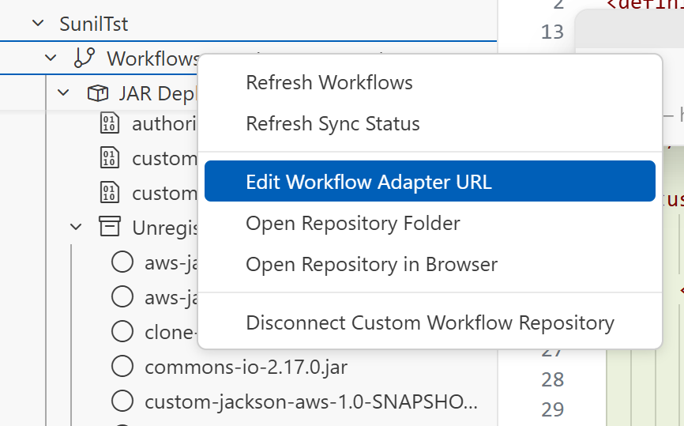
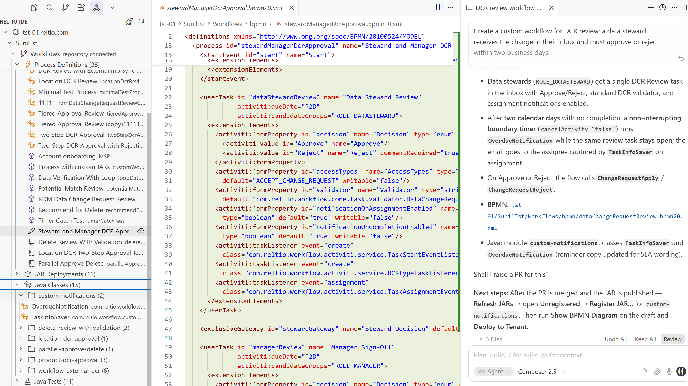
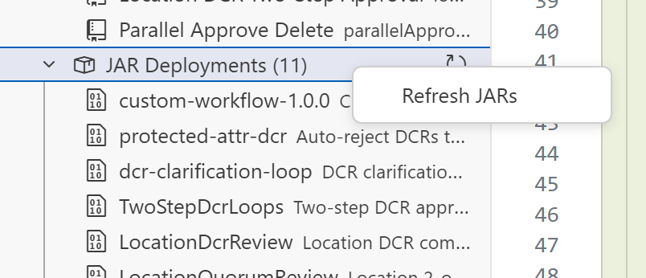

# Reltio IDE

**Model, validate, and deploy your Reltio tenant's business configuration — without leaving VS Code or Cursor.**

---

> **A note on API usage:** Reltio IDE connects to your Reltio environment over the standard Configuration and Platform APIs (for example, when you fetch, apply, or browse configuration history). These calls are counted against the API call entitlements in your SaaS Subscription Agreement with Reltio, the same as any other integration. Typical modeling sessions use a small number of calls, but high-frequency automated use should be scoped with your Reltio account team.

---

## Table of Contents

- [What is Reltio IDE](#what-is-reltio-ide)
- [Capabilities](#capabilities)
- [Prerequisites](#prerequisites)
- [Install Reltio IDE](#install-reltio-ide)
  - [Install on Cursor](#install-on-cursor)
  - [Install on VS Code](#install-on-vs-code)
- [Choose how to connect](#choose-how-to-connect)
- [Connect to your tenant](#connect-to-your-tenant)
- [Connect a Git repository](#connect-a-git-repository)
- [Open and navigate your configuration](#open-and-navigate-your-configuration)
- [Create configuration objects](#create-configuration-objects)
- [Ask the LCA agent](#ask-the-lca-agent)
- [Visualize the ontology](#visualize-the-ontology)
- [Apply configuration and track changes](#apply-configuration-and-track-changes)
- [Workflows](#workflows)
- [Security and credential handling](#security-and-credential-handling)
- [Requirements](#requirements)

---

## What is Reltio IDE

Reltio IDE is an editor extension for building and managing Reltio business configuration (L3) inside VS Code or Cursor. It brings modeling, validation, AI-assisted authoring, a Life Cycle Action (LCA) agent, and a review step into one place.

You open configuration from **either** a live Reltio tenant **or** a Git repository — not both in the same workspace. Choose the source that matches how your team already works, then follow the matching section below.

Reltio IDE supports the people who design and maintain tenant configuration across data governance, integration, and stewardship roles.

---

## Capabilities

| Capability | Description |
|---|---|
| **Tenant connectivity** | Connect securely to your Reltio environment and tenant, and start modeling. |
| **Git repository connectivity** | Connect to your Git repository and fetch the hosted business configuration files. |
| **Intelligent navigation** | Browse the complete business configuration and navigate among entity, relation, interaction, hierarchy, and other object types. |
| **AI-assisted authoring** | Create different object types through guided actions or natural-language prompts. |
| **LCA agent** | Ask about Life Cycle Actions, or generate Java LCA code from your connected configuration. When the type, hook, and attributes already match, it writes one Maven project at `<tenant>/LifeCycle Actions/<type>-<hook>-<name>-lca/` and asks only whether to deploy. After a successful deploy it updates `lifecycleActions`. |
| **Code completion and validation** | Get context-aware suggestions and real-time validation as you edit metadata, so issues surface before deployment, not after. |
| **Automatic dependency management** | Adding a reference attribute automatically creates the relation type it depends on — no separate setup step. |
| **Ontology visualization** | Visualize your full business configuration as an interactive diagram of entity types and their relationships. |
| **Safe deployment** | Review a side-by-side comparison of your changes before they're applied to your tenant, reducing deployment risk. |
| **Version history** | View configuration history, compare any two versions, and see who changed what and when. |
| **Workflow authoring** | Browse, author, and deploy Reltio BPMN workflows and their Java modules — manually or with AI-assisted authoring — from the same tree as your configuration. |

---

## Prerequisites

Before you install Reltio IDE, make sure you have:

- **VS Code** or **Cursor** installed on your machine.
- The Reltio IDE `.vsix` file — download the latest version from the [Releases](../../releases) page of this repository.
- **Either** a Reltio tenant and valid credentials: an **OAuth Client ID and Client secret** (with your SSO routing tenant ID), or a **bearer token**, and permission to read and apply L3 configuration, **or** a git repository of business configuration and **Git** installed on your PATH ([git-scm.com/downloads](https://git-scm.com/downloads)).
- You do not need Reltio credentials to work from a git repository.

---

## Install Reltio IDE

Installation differs slightly by editor. After install, choose a tenant or a Git repository (see [Choose how to connect](#choose-how-to-connect)). The connect steps are the same in Cursor and VS Code.

### Install on Cursor

1. Open Cursor.
2. Press `Cmd+Shift+P` (macOS) or `Ctrl+Shift+P` (Windows/Linux) to open the Command Palette.
3. Type **Install from VSIX**, then select **Extensions: Install from VSIX...**.
4. Browse to the downloaded `.vsix` file, select it, and click **Install**.
5. Confirm that **Reltio IDE** appears in your installed extensions.

  
   
  <em>Screenshot: Command Palette with "Install from VSIX..." selected.</em>

### Install on VS Code

You can install from VSIX using either of the following:

**Option A — Extensions view**

1. Open VS Code.
2. Select the **Extensions** icon in the activity bar.
3. Select the **...** (More Actions) menu at the top of the Extensions view, then select **Install from VSIX...**.
4. Browse to the downloaded `.vsix` file, select it, and click **Install**.

**Option B — Command Palette**

1. Open VS Code.
2. Press `Cmd+Shift+P` (macOS) or `Ctrl+Shift+P` (Windows/Linux) to open the Command Palette.
3. Type **Install from VSIX**, then select **Extensions: Install from VSIX...**.
4. Browse to the downloaded `.vsix` file, select it, and click **Install**.

Either way, confirm that **Reltio IDE** appears in your installed extensions.

  
   
  <em>Screenshot: Command Palette with "Install from VSIX..." selected.</em>

---

## Choose how to connect

Reltio IDE gives you two ways to open business configuration. Pick **one** based on how you work:

| Option | Use when | What you click |
|---|---|---|
| **Reltio tenant** | You want to fetch configuration from a live tenant, edit it, and apply it back | **Connect your Reltio Tenant** |
| **Git repository** | Your business configuration already lives in Git | **Connect your Repository** |

Then follow **[Connect to your tenant](#connect-to-your-tenant)** or **[Connect a Git repository](#connect-a-git-repository)**.

---

## Connect to your tenant

These steps are the same in Cursor and VS Code. Use this path if you chose a **Reltio tenant**.

1. Open a folder in your editor. Reltio IDE requires an open folder before you can connect to a tenant.
2. If you're prompted to trust the folder, select **Trust Folder & Continue**. This appears the first time you open the folder.
3. Select the **Reltio** icon in the activity bar to open the **RELTIO IDE** view.
4. Select **Connect your Reltio Tenant** to launch the setup wizard.
5. Enter your environment ID (for example, `test-usg.reltio.com`).

  
   
  <em>Screenshot (VS Code): Setup wizard, step 1 — enter your environment host.</em>

6. Choose an authentication method:
   - **Sign in with browser** (recommended) — enter your Client ID and Client secret, then your SSO routing tenant ID when prompted. Your editor opens a browser to complete single sign-on, and stores these credentials in your operating system's secure credential store.
   - **Paste a Bearer token** — paste your token and press Enter. The token is kept in memory for the current session only.

  
   
  <em>Screenshot (VS Code): Setup wizard, step 2 — choose Sign in with browser or Paste a Bearer token.</em>

7. After authentication, select your tenant from the list. To connect later instead, select **Skip — I'll add a tenant later**.

---

## Connect a Git repository

These steps are the same in Cursor and VS Code. Use this path if you chose a **Git repository**.

1. Open an empty folder, or a folder that already contains your cloned repository.
2. Select the **Reltio** icon in the activity bar.
3. Select **Connect your Repository**.
4. If the folder is already a git clone, Reltio IDE detects it and skips straight to discovery. Otherwise, enter the remote URL (for example `https://github.com/org/repo.git`) and press Enter.

> **Note:** If you already keep your business configuration in a Git repository, you can edit it without connecting to a live tenant. Authentication uses Git on your machine — Reltio IDE does not collect git credentials.

  
   
  <em>Screenshot (VS Code): Connect your Repository — paste the remote URL to clone.</em>

5. Reltio IDE searches up to 10 folder levels for `BusinessConfig.json` files (the name is not case-sensitive) and lists them in the tree. Configurations at the repository root stay at the root. Configurations in subfolders stay in those folders.

  
   
  <em>Screenshot (VS Code): Connected repository — configurations appear in the RELTIO IDE view, matching the repository folder layout.</em>

### If Git is not installed

Reltio IDE needs Git on your PATH to clone. If it is missing, you see:

> Git executable not found. Install Git (https://git-scm.com/downloads) and ensure it is on your PATH, then try again.

  
   
  <em>Screenshot: Git is not installed — install Git, then retry Connect your Repository.</em>

Install Git from [https://git-scm.com/downloads](https://git-scm.com/downloads), close and reopen the editor, then confirm with `git --version`. When that command prints a version, select **Connect your Repository** again.

### Private repositories

A public repository does not require additional sign-in. For a private repository, complete any sign-in that Git requests.

  
   
  <em>Screenshot: Git may prompt you to sign in before cloning a private repository.</em>

1. Select the account that has access to the repository, then select **Continue**.
2. If none of the listed accounts have access, select **Add a new account** at the bottom of the dialog and complete sign-in in the browser. After you add the account, the same clone flow continues.

You can also add a GitHub account from any terminal, then connect again in Reltio IDE: `git credential-manager github login`.

If Git reports that the repository was not found, the selected account does not have access (or the URL is wrong). Choose another account, or select **Add a new account**.

### Notes

- You can work on **multiple configuration files** in the same repository at the same time.
- **Add Config:** Automatic discovery only looks for `BusinessConfig.json`. To add a file with another name (for example `L3.json`), right-click the `.json` file in the Explorer and select **Add Config**. The file must be a valid Reltio business configuration.
- **Remove Config** drops a single config from the tree, leaving the rest of the repository connected. **Remove Repository** (trash icon in the RELTIO IDE title bar, or right-click the repository row) clears the connection and deletes the folder contents.
- Tenant-only actions (fetch, apply, configuration history) are hidden in this mode. A workspace is connected either to a tenant or to a repository, never both.

---

## Open and navigate your configuration

1. In the **RELTIO IDE** view, select your tenant or configuration.
2. Select the **Open L3** icon beside the row to open the configuration file in the editor.
3. Expand your tenant to browse its configuration folders — entity types, relation types, attribute types, and other object types, based on your L3 configuration.
4. When you are connected to a tenant, right-click the tenant for **Copy Tenant ID**, **Apply Configuration to Tenant**, **Get Configuration**, **View Configuration History**, and options to add new entity types, relation types, and other object types. In a git-connected workspace those tenant-only actions are hidden.

  
   
  <em>Screenshot (VS Code): Connected tenant with its configuration tree expanded.</em>

---

## Create configuration objects

Reltio IDE supports two ways to create configuration objects such as entity types, relation types, and sources.

### Add an object manually

1. In the **RELTIO IDE** view, right-click the object type folder you want to add to — for example, **Entity Types**, **Relation Types**, **Grouping Types**, **Graph Types**, **Sources**, or **Hierarchy Types**.
2. Select **Add a new Entity Type** (or the equivalent action for that folder). The same context menu also offers **Show in Editor** and **Show in Ontology** for existing types.
3. Locate the new object in `L3.reltio.json`. Reltio IDE adds it with a default URI and label, and an empty attributes list.
4. Edit the object to complete its definition — update the label and URI, then add the required attributes and properties.
5. Save `L3.reltio.json` (`Cmd+S` / `Ctrl+S`). Reltio IDE validates your changes and highlights any errors so you can fix them before you apply.

  
   
  <em>Screenshot (VS Code): A new entity type added through the context menu, with default values in the configuration file.</em>

### Create an object with AI-assisted authoring

1. Open your editor's AI assistant.
2. Describe the object you want — for example: *"Create an Employee entity type with the relevant attributes and a reference attribute to Organization."*
3. Review the generated configuration. Reltio IDE creates the entity type, adds relevant attributes, adds the reference attribute, and creates the relation type the reference attribute depends on — automatically.

  
   
  <em>Screenshot: Proposed configuration changes from AI-assisted authoring.</em>

4. Save `L3.reltio.json`. When you work from a git repository, commit and push with your editor's Source Control view instead of applying to a tenant.

**Result:** Your new objects appear in the **RELTIO IDE** view under their object type, and their definitions are added to `L3.reltio.json`. For a reference attribute created with AI-assisted authoring, confirm the supporting relation type appears under Relation Types.

---

## Ask the LCA agent

The LCA agent answers questions about Reltio Life Cycle Actions and can generate Java LCA code from your connected configuration. Use it in Cursor. When the type, hook, and attributes already match that configuration, it writes one Maven project at `<tenant>/LifeCycle Actions/<type>-<hook>-<name>-lca/` and asks only whether to deploy. After a successful deploy it updates `lifecycleActions`. A name that is missing or not an exact match stops the turn.

1. Open a folder. Connect a tenant or a Git repository when the question is about your own types or attributes.
2. In Cursor's agent, ask it to follow the Reltio LCA assistant.
3. Try a prompt such as *"What does the beforeSave hook do?"* or *"Generate a beforeSave LCA for entity type HCP."*

If the assistant is not in the workspace yet, run **Reltio: Resync agent assets (skills, Velocity Packs & LCA knowledge base)** from the Command Palette.

---

## Visualize the ontology

The ontology view displays a diagram of your local configuration — entity types and the relationships between them. It reflects your local file, not the live tenant configuration, and is for visualization only.

1. Right-click **Entity Types** or **Relation Types** in the **RELTIO IDE** view and select **Show in Ontology**.
2. Review the diagram. Each entity type appears as a labeled node showing its name, attribute count, connection count, and match rule count. Entity types marked **★ Consolidated** apply match and survivorship rules; entity types marked **Abstract** are base types that other entity types extend and don't hold records directly.
3. Labeled arrows show relation type names, `extends` inheritance connections, and reference attribute connections.

  
   
  <em>Screenshot (VS Code): Ontology view with entity type nodes (attribute/connection counts, Consolidated markers) and labeled relationship arrows.</em>

---

## Apply configuration and track changes

These workflows require a tenant connection. In a git-connected workspace, Reltio IDE hides **Get Configuration**, **Apply Configuration to Tenant**, and **View Configuration History**. Save your edits, then commit and push them with your editor's Source Control view.

Reltio IDE supports two tenant configuration-management workflows: **Get Configuration** syncs your local file with the tenant, and **Apply Configuration to Tenant** deploys your local changes.

### Fetch and apply configuration

1. Right-click your tenant and select **Get Configuration** to retrieve the latest configuration from the tenant. Reltio IDE updates your local `L3.reltio.json` once complete.
2. If your local file has unpublished changes, Reltio IDE warns that fetching will overwrite them. Choose **Review changes** to open a diff, or **Fetch anyway** to replace the local file immediately. After a review you can **Fetch and overwrite**, **Apply my changes instead** (push local edits to the tenant), or **Cancel**.
3. Edit `L3.reltio.json` with the changes you want to apply.
4. Right-click your tenant and select **Apply Configuration to Tenant**.

  
   
  <em>Screenshot (VS Code): Apply Configuration to Tenant from the tenant context menu.</em>

Reltio IDE checks whether the remote configuration matches your last fetch and shows a confirmation dialog:

  
   
  <em>Screenshot: Confirmation before applying configuration to the tenant.</em>

   - **View changes** — open a diff, then confirm with **Apply to tenant** or choose **Don't apply**.
   - **Yes** — apply your local configuration to the tenant immediately (shown when the remote still matches your last fetch).
   - **Don't apply** — cancel and return to editing.

If the tenant configuration changed since your last fetch, the dialog asks you to **Review changes** before you can apply. **Skip** cancels.

### Review configuration history

1. Right-click your tenant and select **View Configuration History**. A **History** section lists past versions by timestamp and the user who made each change.

  
   
  <em>Screenshot (VS Code): Configuration history entries under the tenant.</em>

2. Right-click the **History** folder and select **Fetch More Configuration History** to load older entries.
3. Select a history entry to open that version of the configuration.
4. Compare versions:
   - **Compare with Current L3** — compares a snapshot against your current local configuration.
   - **Compare with Previous Snapshot** — compares a snapshot against the version before it.
   - **Select for Compare**, then **Compare Selected** on a second snapshot — compares any two versions.

---

## Workflows

Reltio IDE brings your tenant's BPMN workflows into the same view as your business configuration. Browse the workflows and JAR packages on your tenant, preview them, create or change a workflow, and deploy it. When a workflow needs custom Java, connect a Custom Workflow Repository and use the AI agent to build the Java and the workflow together.

**Workflow tasks**

| Task | Description |
|---|---|
| **[Browse your workflows](#browse-your-workflows)** | View the workflows and JAR packages on your tenant. |
| **[Open and preview a workflow](#open-and-preview-a-workflow)** | Open a workflow's BPMN file and view it as a diagram. |
| **[Create a workflow](#create-a-workflow)** | Create a draft manually, duplicate an existing workflow, or describe it to the AI agent. |
| **[Deploy a workflow](#deploy-a-workflow)** | Publish a draft or an edited workflow to your tenant. |
| **[Connect a Custom Workflow Repository](#connect-a-custom-workflow-repository)** | Connect the repository that holds the Java code for custom workflows. |
| **[Build a workflow that needs custom Java](#build-a-workflow-that-needs-custom-java)** | Use the AI agent to write the Java and the BPMN together, and raise a pull request. |
| **[Register the JAR and deploy the workflow](#register-the-jar-and-deploy-the-workflow)** | Register the Java package that Reltio builds, then deploy the workflow that uses it. |

  
   
  <em>Screenshot (VS Code): The Workflows folder under a connected tenant.</em>

### Browse your workflows

1. In the **RELTIO IDE** view, expand your tenant's **Workflows** folder. Reltio IDE finds your tenant's Workflow Adapter URL automatically and downloads a copy of every deployed workflow in the background.
2. Expand **Process Definitions** to see all workflows in one list. The icon in front of each row shows where the workflow comes from:
   -  **Class icon** — a custom workflow deployed on your tenant. It reads **• local changes** when you have edited its local copy and not yet deployed it.
   -  **Method icon** — a workflow that Reltio provides.
   -  **Pencil icon, • draft** — a workflow that has not been deployed yet.
   -  **Repository icon** — a workflow file from your connected Custom Workflow Repository. It always has its own row, even when a deployed workflow has the same ID.
3. Expand **JAR Deployments** to see the Java packages registered against your tenant, and the **Unregistered** packages that Reltio IDE finds but your tenant does not use yet.

  
   
  <em>Screenshot (VS Code): Process Definitions — custom workflows first, then workflows that Reltio provides.</em>

  
   
  <em>Screenshot (VS Code): JAR Deployments — registered packages, and the Unregistered folder below them.</em>

You can see your BPMN files in the file explorer, in `Workflows/bpmn/` under your tenant folder. Each downloaded workflow also has a `.baseline.xml` file that Reltio IDE uses to detect your changes. Leave it in place; Git ignores it in a connected repository.

### Open and preview a workflow

1. Select a workflow in **Process Definitions** to open its BPMN file in the editor.
2. Right-click the workflow and select **Show BPMN Diagram** to see the process drawn as a diagram next to the file. If the file is not valid XML, the preview shows the first problem and its line number.

  
   
  <em>Screenshot (VS Code): A workflow open in the editor. The file is in the bpmn folder under Workflows.</em>

  
   
  <em>Screenshot (VS Code): Show BPMN Diagram — the process drawn next to its file.</em>

### Create a workflow

Create a workflow manually, or describe it to the AI agent. Either way, the new workflow is a draft until you deploy it.

#### Create a draft manually

1. Right-click **Process Definitions** and select **New Workflow...**, or right-click an existing workflow and select **Duplicate as Draft...**.
2. Enter an ID and a display name. The ID is the workflow's technical identifier on the tenant. Deploying an ID that already exists replaces that workflow.
3. Edit the draft's `.bpmn20.xml` file. **New Workflow...** starts from a starter process: a start event, a review task, and an end event.
4. Right-click the draft and select **Show BPMN Diagram** to preview the process.

**Result:** The workflow appears in **Process Definitions** with the pencil icon, marked **• draft**.

#### Create a workflow with the AI agent

1. Open your editor's AI assistant.
2. Describe the use case — for example: *"When someone submits a data change request, a data steward must approve or reject it. If approved, a manager gives final sign-off."*
3. Review the result. The assistant states the process ID it used, and saves the workflow as a draft.

  
   
  <em>Screenshot (Cursor): The AI assistant creating a workflow. The new draft is open in the editor and listed in Process Definitions.</em>

**Result:** The new workflow appears in **Process Definitions** marked **• draft**.

If the use case needs custom Java, the assistant asks you to connect a Custom Workflow Repository first. See [Build a workflow that needs custom Java](#build-a-workflow-that-needs-custom-java).

### Deploy a workflow

1. Right-click a draft, or a deployed workflow you have edited, and select **Deploy to Tenant**.
2. Confirm. Deploying an ID that is already live replaces that workflow on the tenant.

  
   
  <em>Screenshot (VS Code): The menu on a draft — Show BPMN Diagram, Deploy to Tenant and Delete Draft.</em>

**Result:** The workflow is live on your tenant, and the **• draft** or **• local changes** marker is removed.

**Changing a workflow that is already deployed**

1. Select the workflow and edit its BPMN file. The row now reads **• local changes**.
2. Right-click the workflow and select **Compare with Last Fetch** to review a diff, or **Discard Local Changes** to revert to the last fetched version.
3. Deploy the change as described above.

If the workflow changed on the tenant after you downloaded it, Reltio IDE warns you before it overwrites that change. To pick up changes made elsewhere, right-click **Process Definitions** and select **Refresh BPMNs**. If the refresh would overwrite your edits, Reltio IDE asks you first and lets you review each one.

### Connect a Custom Workflow Repository

You need a Custom Workflow Repository to write workflows that need custom Java code. The repository holds the Java, and Reltio reviews and builds it.

1. Right-click **Workflows** and select **Connect Custom Workflow Repository...**.
2. Enter the Git URL for your Custom Workflow Repository. Reltio IDE clones the repository into the tenant's `Workflows/` folder, so its `bpmn/` folder is the same folder as your workflows.

  
   
  <em>Screenshot (VS Code): Connect Custom Workflow Repository — enter the Git URL.</em>

Existing files are handled as follows:

- Drafts already in `Workflows/bpmn/` stay there. A message confirms they are now part of the repository's `bpmn` folder and are included the next time you commit.
- If a draft has the same name as a workflow the repository already tracks, your local copy is kept and Git shows it as modified.
- If any other file has the same name as one in the repository, nothing is changed and the message lists the files. Rename them and connect again.

**Result:** **Java Classes** and **Java Tests** appear, grouped by module, and the repository's workflows are added to **Process Definitions**.

  
   
  <em>Screenshot (VS Code): A connected repository — Java Classes and Java Tests, grouped by module.</em>

Each repository workflow has its own row and shows how it compares with the tenant: **• not deployed**, **• differs from tenant**, **• same as tenant**, or **• deployed • not compared yet**.

  
   
  <em>Screenshot (VS Code): A draft and workflows from the repository, marked • repository • not deployed.</em>

Right-click **Workflows** to manage the connection:

- **Refresh Sync Status** updates the comparison with the tenant.
- **Edit Workflow Adapter URL** changes the URL Reltio IDE uses to reach the tenant's workflows.
- **Open Repository Folder** and **Open Repository in Browser** open the repository.
- **Disconnect Custom Workflow Repository** removes the connection. See [Disconnect a Custom Workflow Repository](#disconnect-a-custom-workflow-repository).

  
   
  <em>Screenshot (VS Code): The Workflows menu once a repository is connected.</em>

Workflows downloaded from your tenant are stored in the same folder as the repository's own. When you commit, stage only the files you intend to share.

### Build a workflow that needs custom Java

A workflow needs Java when it must do something the standard building blocks cannot — for example, send a custom notification, call an external system, or apply only to a specific entity type. Java is delivered through your Custom Workflow Repository and reviewed by Reltio.

1. [Connect your Custom Workflow Repository](#connect-a-custom-workflow-repository).
2. In your editor's AI assistant, describe the use case.
3. The assistant writes the Java files in the relevant module folders of your repository, and the BPMN as a draft in `Workflows/bpmn/`. The draft already calls the new Java class. The Java appears under **Java Classes** and **Java Tests**, and the workflow under **Process Definitions** marked **• draft**.
4. Review the Java and the BPMN draft. When you are satisfied, raise a pull request. Reltio reviews the pull request and builds the Java package (JAR) from it.

  
   
  <em>Screenshot (Cursor): The assistant summarises the workflow and its Java classes, asks "Shall I raise a PR for this?", and lists the next steps.</em>

**Result:** The pull request is open. Do not deploy the workflow yet — it calls Java that is not on your tenant until Reltio has built the package.

### Register the JAR and deploy the workflow

After the pull request is merged and Reltio has built the Java package:

1. Right-click **JAR Deployments** and select **Refresh JARs**. The new package appears under **Unregistered**.

  
   
  <em>Screenshot (VS Code): Refresh JARs on JAR Deployments.</em>

2. Right-click the package and select **Register JAR...**.

  
   
  <em>Screenshot (VS Code): Register JAR... on a package under Unregistered.</em>

3. Right-click the draft workflow and select **Deploy to Tenant**.

**Result:** The package moves from **Unregistered** to the registered list. The workflow is now live on your tenant and calls your Java.

With the JAR registered, you only need to deploy the related BPMN to make the workflow live.

### Disconnect a Custom Workflow Repository

1. Right-click **Workflows** and select **Disconnect Custom Workflow Repository**.
2. Review the message, which states how many files are removed and how many are kept, and confirm.

- **Removed** — the repository's files, including its Java, so you can connect a different repository afterwards.
- **Kept** — your drafts, workflows downloaded from the tenant, files you added yourself, and any change you made but have not committed.

Push any unpushed commits before you disconnect.

---

## Security and credential handling

- **Browser OAuth (recommended):** your Client ID, Client secret, and session are handled through single sign-on and stored in your operating system's secure credential store — never in a plaintext file.
- **Bearer token:** kept in memory only for the current session and cleared on restart. It is never written to `settings.json` or committed to your workspace.
- **Git repositories:** clone and private-repository access use Git on your machine and its credential helper. Reltio IDE never asks you to place a git password or token in workspace settings.
- Reltio IDE never asks you to place a token, client secret, or password directly in workspace settings.
- **LCA agent:** ask it for an environment-variable or credential-reference name. Do not paste a secret key, password, or token into the chat.

---

## Requirements

- VS Code or Cursor
- For tenant mode: a Reltio tenant and valid credentials (OAuth Client ID/Client secret + SSO routing tenant ID, or a bearer token), and permission to read and apply L3 configuration
- For repository mode: Git installed on your PATH, and access to clone if the repository is private.

---

*Copyright © 2026 Reltio, Inc. All rights reserved.*
