

# Reltio IDE

**Model, validate, and deploy your Reltio tenant's business configuration — without leaving VS Code or Cursor.**

---

> **A note on API usage:** Reltio IDE connects to your Reltio environment over the standard Configuration and Platform APIs (for example, when you fetch, apply, or browse configuration history). These calls are counted against the API call entitlements in your SaaS Subscription Agreement with Reltio, the same as any other integration. Typical modeling sessions use a small number of calls, but high-frequency automated use should be scoped with your Reltio account team.

---

## Table of Contents

- [What is Reltio IDE](#what-is-reltio-ide)
- [Capabilities](#capabilities)
- [Prerequisites](#prerequisites)
- [Install Reltio IDE](#install-reltio-ide)
  - [Install on Cursor](#install-on-cursor)
  - [Install on VS Code](#install-on-vs-code)
- [Choose how to connect](#choose-how-to-connect)
- [Connect to your tenant](#connect-to-your-tenant)
- [Connect a Git repository](#connect-a-git-repository)
- [Open and navigate your configuration](#open-and-navigate-your-configuration)
- [Create configuration objects](#create-configuration-objects)
- [Ask the LCA agent](#ask-the-lca-agent)
- [Visualize the ontology](#visualize-the-ontology)
- [Apply configuration and track changes](#apply-configuration-and-track-changes)
- [Workflows](#workflows)
- [Security and credential handling](#security-and-credential-handling)
- [Requirements](#requirements)

---

## What is Reltio IDE

Reltio IDE is an editor extension for building and managing Reltio business configuration (L3) inside VS Code or Cursor. It brings modeling, validation, AI-assisted authoring, a Life Cycle Action (LCA) agent, and a review step into one place.

You open configuration from **either** a live Reltio tenant **or** a Git repository — not both in the same workspace. Choose the source that matches how your team already works, then follow the matching section below.

Reltio IDE supports the people who design and maintain tenant configuration across data governance, integration, and stewardship roles.

---

## Capabilities

| Capability | Description |
|---|---|
| **Tenant connectivity** | Connect securely to your Reltio environment and tenant, and start modeling. |
| **Git repository connectivity** | Connect to your Git repository and fetch the hosted business configuration files. |
| **Intelligent navigation** | Browse the complete business configuration and navigate among entity, relation, interaction, hierarchy, and other object types. |
| **AI-assisted authoring** | Create different object types through guided actions or natural-language prompts. |
| **LCA agent** | Ask about Life Cycle Actions, or generate Java LCA code from your connected configuration. When the type, hook, and attributes already match, it writes one Maven project at `<tenant>/LifeCycle Actions/<type>-<hook>-<name>-lca/` and asks only whether to deploy. After a successful deploy it updates `lifecycleActions`. |
| **Code completion and validation** | Get context-aware suggestions and real-time validation as you edit metadata, so issues surface before deployment, not after. |
| **Automatic dependency management** | Adding a reference attribute automatically creates the relation type it depends on — no separate setup step. |
| **Ontology visualization** | Visualize your full business configuration as an interactive diagram of entity types and their relationships. |
| **Safe deployment** | Review a side-by-side comparison of your changes before they're applied to your tenant, reducing deployment risk. |
| **Version history** | View configuration history, compare any two versions, and see who changed what and when. |
| **Workflow authoring** | Browse, author, and deploy Reltio BPMN workflows and their Java modules — manually or with AI-assisted authoring — from the same tree as your configuration. |

---

## Prerequisites

Before you install Reltio IDE, make sure you have:

- **VS Code** or **Cursor** installed on your machine.
- The Reltio IDE `.vsix` file — download the latest version from the [Releases](../../releases) page of this repository.
- **Either** a Reltio tenant and valid credentials: an **OAuth Client ID and Client secret** (with your SSO routing tenant ID), or a **bearer token**, and permission to read and apply L3 configuration, **or** a git repository of business configuration and **Git** installed on your PATH ([git-scm.com/downloads](https://git-scm.com/downloads)).
- You do not need Reltio credentials to work from a git repository.

---

## Install Reltio IDE

Installation differs slightly by editor. After install, choose a tenant or a Git repository (see [Choose how to connect](#choose-how-to-connect)). The connect steps are the same in Cursor and VS Code.

### Install on Cursor

1. Open Cursor.
2. Press `Cmd+Shift+P` (macOS) or `Ctrl+Shift+P` (Windows/Linux) to open the Command Palette.
3. Type **Install from VSIX**, then select **Extensions: Install from VSIX...**.
4. Browse to the downloaded `.vsix` file, select it, and click **Install**.
5. Confirm that **Reltio IDE** appears in your installed extensions.

  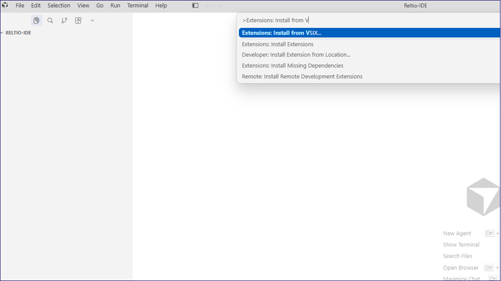
   
  <em>Screenshot: Command Palette with "Install from VSIX..." selected.</em>

### Install on VS Code

You can install from VSIX using either of the following:

**Option A — Extensions view**

1. Open VS Code.
2. Select the **Extensions** icon in the activity bar.
3. Select the **...** (More Actions) menu at the top of the Extensions view, then select **Install from VSIX...**.
4. Browse to the downloaded `.vsix` file, select it, and click **Install**.

**Option B — Command Palette**

1. Open VS Code.
2. Press `Cmd+Shift+P` (macOS) or `Ctrl+Shift+P` (Windows/Linux) to open the Command Palette.
3. Type **Install from VSIX**, then select **Extensions: Install from VSIX...**.
4. Browse to the downloaded `.vsix` file, select it, and click **Install**.

Either way, confirm that **Reltio IDE** appears in your installed extensions.

  
   
  <em>Screenshot: Command Palette with "Install from VSIX..." selected.</em>

---

## Choose how to connect

Reltio IDE gives you two ways to open business configuration. Pick **one** based on how you work:

| Option | Use when | What you click |
|---|---|---|
| **Reltio tenant** | You want to fetch configuration from a live tenant, edit it, and apply it back | **Connect your Reltio Tenant** |
| **Git repository** | Your business configuration already lives in Git | **Connect your Repository** |

Then follow **[Connect to your tenant](#connect-to-your-tenant)** or **[Connect a Git repository](#connect-a-git-repository)**.

---

## Connect to your tenant

These steps are the same in Cursor and VS Code. Use this path if you chose a **Reltio tenant**.

1. Open a folder in your editor. Reltio IDE requires an open folder before you can connect to a tenant.
2. If you're prompted to trust the folder, select **Trust Folder & Continue**. This appears the first time you open the folder.
3. Select the **Reltio** icon in the activity bar to open the **RELTIO IDE** view.
4. Select **Connect your Reltio Tenant** to launch the setup wizard.
5. Enter your environment ID (for example, `test-usg.reltio.com`).

  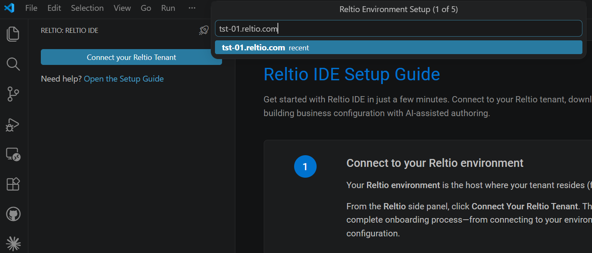
   
  <em>Screenshot (VS Code): Setup wizard, step 1 — enter your environment host.</em>

6. Choose an authentication method:
   - **Sign in with browser** (recommended) — enter your Client ID and Client secret, then your SSO routing tenant ID when prompted. Your editor opens a browser to complete single sign-on, and stores these credentials in your operating system's secure credential store.
   - **Paste a Bearer token** — paste your token and press Enter. The token is kept in memory for the current session only.

  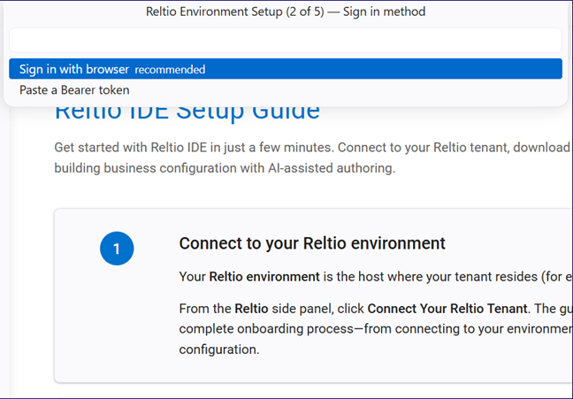
   
  <em>Screenshot (VS Code): Setup wizard, step 2 — choose Sign in with browser or Paste a Bearer token.</em>

7. After authentication, select your tenant from the list. To connect later instead, select **Skip — I'll add a tenant later**.

---

## Connect a Git repository

These steps are the same in Cursor and VS Code. Use this path if you chose a **Git repository**.

1. Open an empty folder, or a folder that already contains your cloned repository.
2. Select the **Reltio** icon in the activity bar.
3. Select **Connect your Repository**.
4. If the folder is already a git clone, Reltio IDE detects it and skips straight to discovery. Otherwise, enter the remote URL (for example `https://github.com/org/repo.git`) and press Enter.

> **Note:** If you already keep your business configuration in a Git repository, you can edit it without connecting to a live tenant. Authentication uses Git on your machine — Reltio IDE does not collect git credentials.

  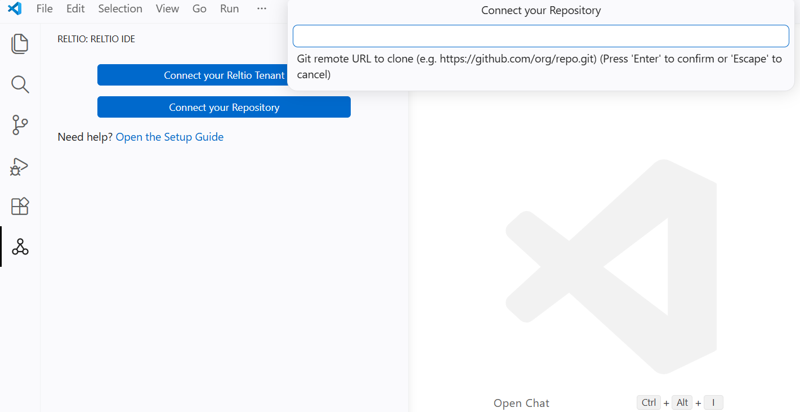
   
  <em>Screenshot (VS Code): Connect your Repository — paste the remote URL to clone.</em>

5. Reltio IDE searches up to 10 folder levels for `BusinessConfig.json` files (the name is not case-sensitive) and lists them in the tree. Configurations at the repository root stay at the root. Configurations in subfolders stay in those folders.

  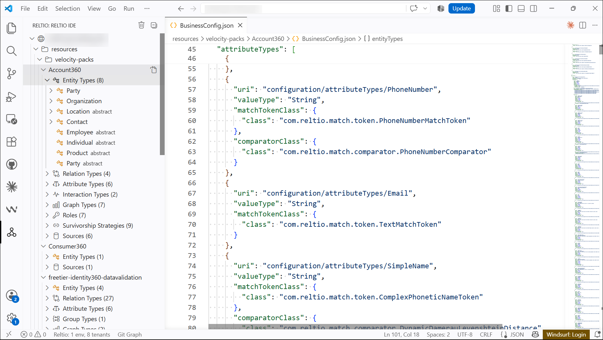
   
  <em>Screenshot (VS Code): Connected repository — configurations appear in the RELTIO IDE view, matching the repository folder layout.</em>

### If Git is not installed

Reltio IDE needs Git on your PATH to clone. If it is missing, you see:

> Git executable not found. Install Git (https://git-scm.com/downloads) and ensure it is on your PATH, then try again.

  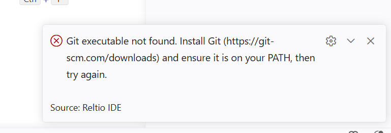
   
  <em>Screenshot: Git is not installed — install Git, then retry Connect your Repository.</em>

Install Git from [https://git-scm.com/downloads](https://git-scm.com/downloads), close and reopen the editor, then confirm with `git --version`. When that command prints a version, select **Connect your Repository** again.

### Private repositories

A public repository does not require additional sign-in. For a private repository, complete any sign-in that Git requests.

  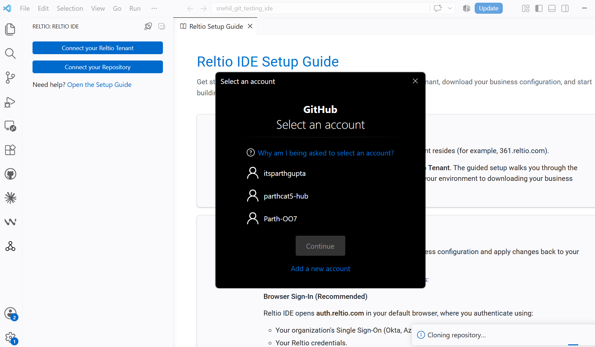
   
  <em>Screenshot: Git may prompt you to sign in before cloning a private repository.</em>

1. Select the account that has access to the repository, then select **Continue**.
2. If none of the listed accounts have access, select **Add a new account** at the bottom of the dialog and complete sign-in in the browser. After you add the account, the same clone flow continues.

You can also add a GitHub account from any terminal, then connect again in Reltio IDE: `git credential-manager github login`.

If Git reports that the repository was not found, the selected account does not have access (or the URL is wrong). Choose another account, or select **Add a new account**.

### Notes

- You can work on **multiple configuration files** in the same repository at the same time.
- **Add Config:** Automatic discovery only looks for `BusinessConfig.json`. To add a file with another name (for example `L3.json`), right-click the `.json` file in the Explorer and select **Add Config**. The file must be a valid Reltio business configuration.
- **Remove Config** drops a single config from the tree, leaving the rest of the repository connected. **Remove Repository** (trash icon in the RELTIO IDE title bar, or right-click the repository row) clears the connection and deletes the folder contents.
- Tenant-only actions (fetch, apply, configuration history) are hidden in this mode. A workspace is connected either to a tenant or to a repository, never both.

---

## Open and navigate your configuration

1. In the **RELTIO IDE** view, select your tenant or configuration.
2. Select the **Open L3** icon beside the row to open the configuration file in the editor.
3. Expand your tenant to browse its configuration folders — entity types, relation types, attribute types, and other object types, based on your L3 configuration.
4. When you are connected to a tenant, right-click the tenant for **Copy Tenant ID**, **Apply Configuration to Tenant**, **Get Configuration**, **View Configuration History**, and options to add new entity types, relation types, and other object types. In a git-connected workspace those tenant-only actions are hidden.

  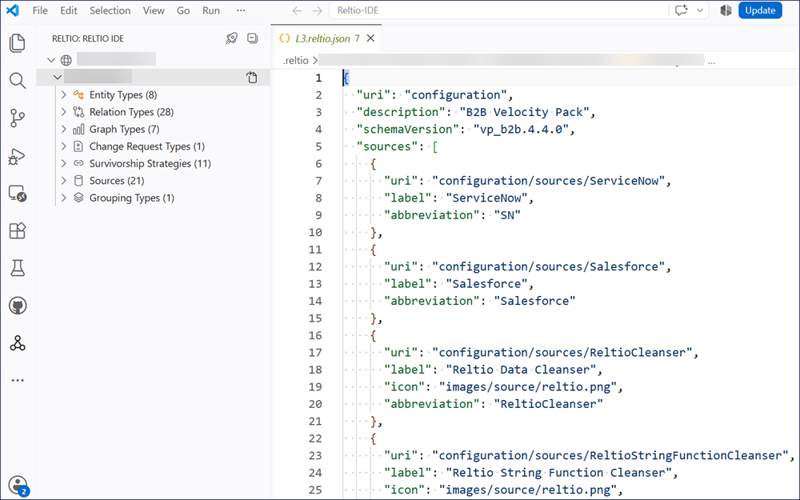
   
  <em>Screenshot (VS Code): Connected tenant with its configuration tree expanded.</em>

---

## Create configuration objects

Reltio IDE supports two ways to create configuration objects such as entity types, relation types, and sources.

### Add an object manually

1. In the **RELTIO IDE** view, right-click the object type folder you want to add to — for example, **Entity Types**, **Relation Types**, **Grouping Types**, **Graph Types**, **Sources**, or **Hierarchy Types**.
2. Select **Add a new Entity Type** (or the equivalent action for that folder). The same context menu also offers **Show in Editor** and **Show in Ontology** for existing types.
3. Locate the new object in `L3.reltio.json`. Reltio IDE adds it with a default URI and label, and an empty attributes list.
4. Edit the object to complete its definition — update the label and URI, then add the required attributes and properties.
5. Save `L3.reltio.json` (`Cmd+S` / `Ctrl+S`). Reltio IDE validates your changes and highlights any errors so you can fix them before you apply.

  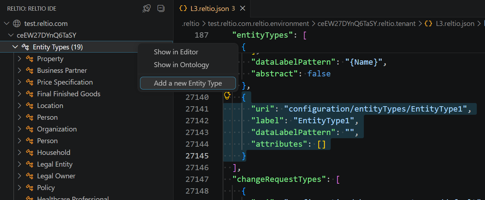
   
  <em>Screenshot (VS Code): A new entity type added through the context menu, with default values in the configuration file.</em>

### Create an object with AI-assisted authoring

1. Open your editor's AI assistant.
2. Describe the object you want — for example: *"Create an Employee entity type with the relevant attributes and a reference attribute to Organization."*
3. Review the generated configuration. Reltio IDE creates the entity type, adds relevant attributes, adds the reference attribute, and creates the relation type the reference attribute depends on — automatically.

  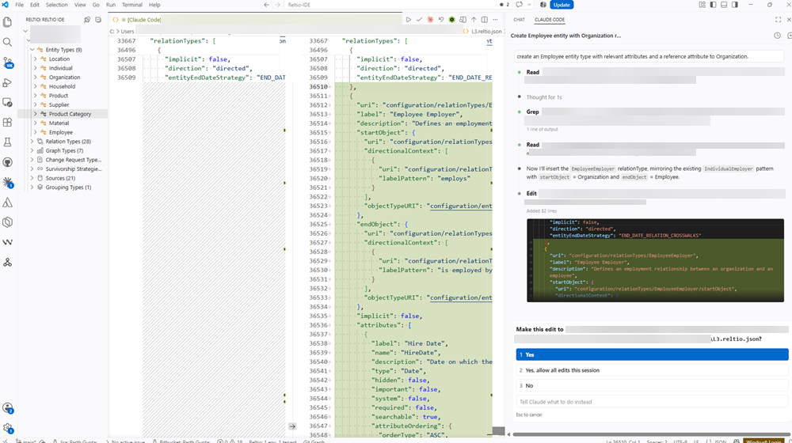
   
  <em>Screenshot: Proposed configuration changes from AI-assisted authoring.</em>

4. Save `L3.reltio.json`. When you work from a git repository, commit and push with your editor's Source Control view instead of applying to a tenant.

**Result:** Your new objects appear in the **RELTIO IDE** view under their object type, and their definitions are added to `L3.reltio.json`. For a reference attribute created with AI-assisted authoring, confirm the supporting relation type appears under Relation Types.

---

## Ask the LCA agent

The LCA agent answers questions about Reltio Life Cycle Actions and can generate Java LCA code from your connected configuration. Use it in Cursor. When the type, hook, and attributes already match that configuration, it writes one Maven project at `<tenant>/LifeCycle Actions/<type>-<hook>-<name>-lca/` and asks only whether to deploy. After a successful deploy it updates `lifecycleActions`. A name that is missing or not an exact match stops the turn.

1. Open a folder. Connect a tenant or a Git repository when the question is about your own types or attributes.
2. In Cursor's agent, ask it to follow the Reltio LCA assistant.
3. Try a prompt such as *"What does the beforeSave hook do?"* or *"Generate a beforeSave LCA for entity type HCP."*

If the assistant is not in the workspace yet, run **Reltio: Resync agent assets (skills, Velocity Packs & LCA knowledge base)** from the Command Palette.

---

## Visualize the ontology

The ontology view displays a diagram of your local configuration — entity types and the relationships between them. It reflects your local file, not the live tenant configuration, and is for visualization only.

1. Right-click **Entity Types** or **Relation Types** in the **RELTIO IDE** view and select **Show in Ontology**.
2. Review the diagram. Each entity type appears as a labeled node showing its name, attribute count, connection count, and match rule count. Entity types marked **★ Consolidated** apply match and survivorship rules; entity types marked **Abstract** are base types that other entity types extend and don't hold records directly.
3. Labeled arrows show relation type names, `extends` inheritance connections, and reference attribute connections.

  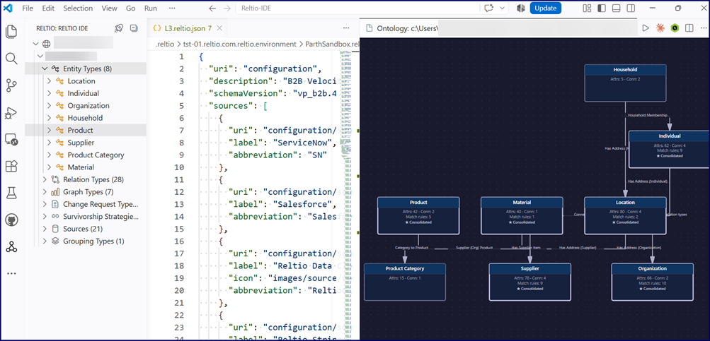
   
  <em>Screenshot (VS Code): Ontology view with entity type nodes (attribute/connection counts, Consolidated markers) and labeled relationship arrows.</em>

---

## Apply configuration and track changes

These workflows require a tenant connection. In a git-connected workspace, Reltio IDE hides **Get Configuration**, **Apply Configuration to Tenant**, and **View Configuration History**. Save your edits, then commit and push them with your editor's Source Control view.

Reltio IDE supports two tenant configuration-management workflows: **Get Configuration** syncs your local file with the tenant, and **Apply Configuration to Tenant** deploys your local changes.

### Fetch and apply configuration

1. Right-click your tenant and select **Get Configuration** to retrieve the latest configuration from the tenant. Reltio IDE updates your local `L3.reltio.json` once complete.
2. If your local file has unpublished changes, Reltio IDE warns that fetching will overwrite them. Choose **Review changes** to open a diff, or **Fetch anyway** to replace the local file immediately. After a review you can **Fetch and overwrite**, **Apply my changes instead** (push local edits to the tenant), or **Cancel**.
3. Edit `L3.reltio.json` with the changes you want to apply.
4. Right-click your tenant and select **Apply Configuration to Tenant**.

  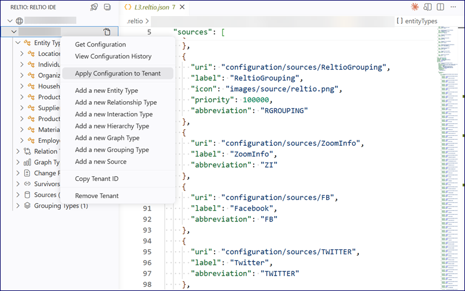
   
  <em>Screenshot (VS Code): Apply Configuration to Tenant from the tenant context menu.</em>

Reltio IDE checks whether the remote configuration matches your last fetch and shows a confirmation dialog:

  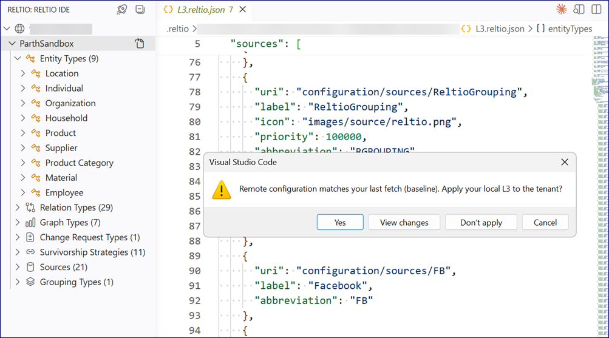
   
  <em>Screenshot: Confirmation before applying configuration to the tenant.</em>

   - **View changes** — open a diff, then confirm with **Apply to tenant** or choose **Don't apply**.
   - **Yes** — apply your local configuration to the tenant immediately (shown when the remote still matches your last fetch).
   - **Don't apply** — cancel and return to editing.

If the tenant configuration changed since your last fetch, the dialog asks you to **Review changes** before you can apply. **Skip** cancels.

### Review configuration history

1. Right-click your tenant and select **View Configuration History**. A **History** section lists past versions by timestamp and the user who made each change.

  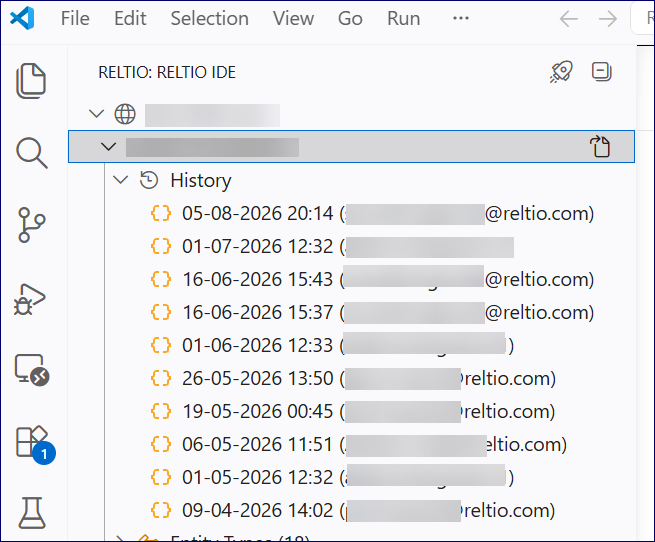
   
  <em>Screenshot (VS Code): Configuration history entries under the tenant.</em>

2. Right-click the **History** folder and select **Fetch More Configuration History** to load older entries.
3. Select a history entry to open that version of the configuration.
4. Compare versions:
   - **Compare with Current L3** — compares a snapshot against your current local configuration.
   - **Compare with Previous Snapshot** — compares a snapshot against the version before it.
   - **Select for Compare**, then **Compare Selected** on a second snapshot — compares any two versions.

---

## Workflows

Reltio IDE gives you one place to see, change, create and deploy the BPMN workflows on your tenant, and to write the Java that custom workflows sometimes need. You work in the same view as your business configuration, and an AI assistant can build a workflow for you from a plain description.

Workflows need a connected tenant. They are not available in a workspace opened from a Git repository.

  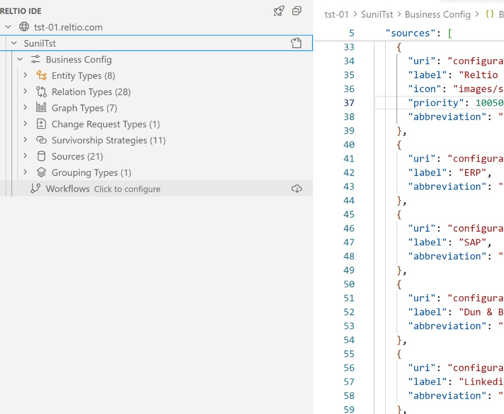
   
  <em>Screenshot: The Workflows row under your connected tenant.</em>

**What you can do, in the order most teams do it**

1. [See what is on your tenant](#1-see-what-is-on-your-tenant)
2. [Change a workflow that is already deployed](#2-change-a-workflow-that-is-already-deployed)
3. [Create a new workflow](#3-create-a-new-workflow)
4. [Build a workflow that needs custom Java](#4-build-a-workflow-that-needs-custom-java)
5. [Keep your workflows in Git](#5-keep-your-workflows-in-git)
6. [Quick reference](#6-quick-reference)

---

### 1. See what is on your tenant

Expand **Workflows** under your tenant. The first time, Reltio IDE finds your tenant's workflow service on its own. You only need to set its address by hand if it is not found: right-click **Workflows**, select **Edit Workflow Adapter URL**, and enter it.

You see two folders:

- **Process Definitions** — every workflow, in one list.
- **JAR Deployments** — the custom Java packages registered on your tenant.

Reltio IDE also downloads a copy of every deployed workflow in the background, so you can open any of them straight away without waiting. Your own copies are never overwritten by this.

The icon in front of each workflow tells you where it comes from:

| Icon | What it is |
|---|---|
| Method | A workflow that Reltio provides |
| Class | Your own workflow, deployed on the tenant |
| Pencil, marked **draft** | A workflow you are working on that is not deployed yet |
| Repository | A workflow that lives in your connected Git repository (see [step 5](#5-keep-your-workflows-in-git)) |

  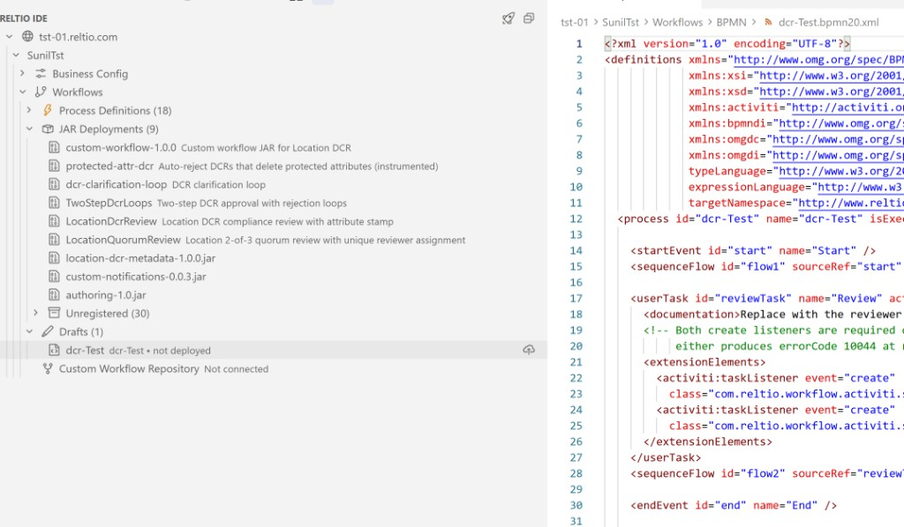
   
  <em>Screenshot: Process Definitions and JAR Deployments, with each icon type visible.</em>

Click any workflow to open it in the editor. Right-click it and select **Show BPMN Diagram** to see it drawn as a diagram. If the file cannot be read as valid BPMN, the preview tells you which line is wrong instead of showing an empty canvas.

  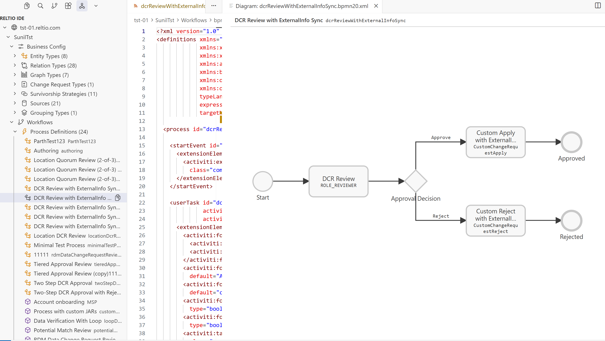
   
  <em>Screenshot: Show BPMN Diagram.</em>

---

### 2. Change a workflow that is already deployed

1. Click the workflow to open it, and edit it. The row now reads **local changes**.
2. Right-click it and select **Compare with Last Fetch** to see exactly what you changed. Select **Discard Local Changes** if you want to go back to what is on the tenant.
3. Select **Show BPMN Diagram** to check the result.
4. Select **Deploy to Tenant**. You are asked to confirm first, because deploying a workflow that is already live replaces it for everyone on the tenant.

If someone else changed the same workflow on the tenant since you downloaded it, Reltio IDE warns you before it overwrites their change.

Select **Refresh BPMNs** on **Process Definitions** to pick up changes made elsewhere. If any of your own edits would be overwritten, you are asked first and can review them one by one.

  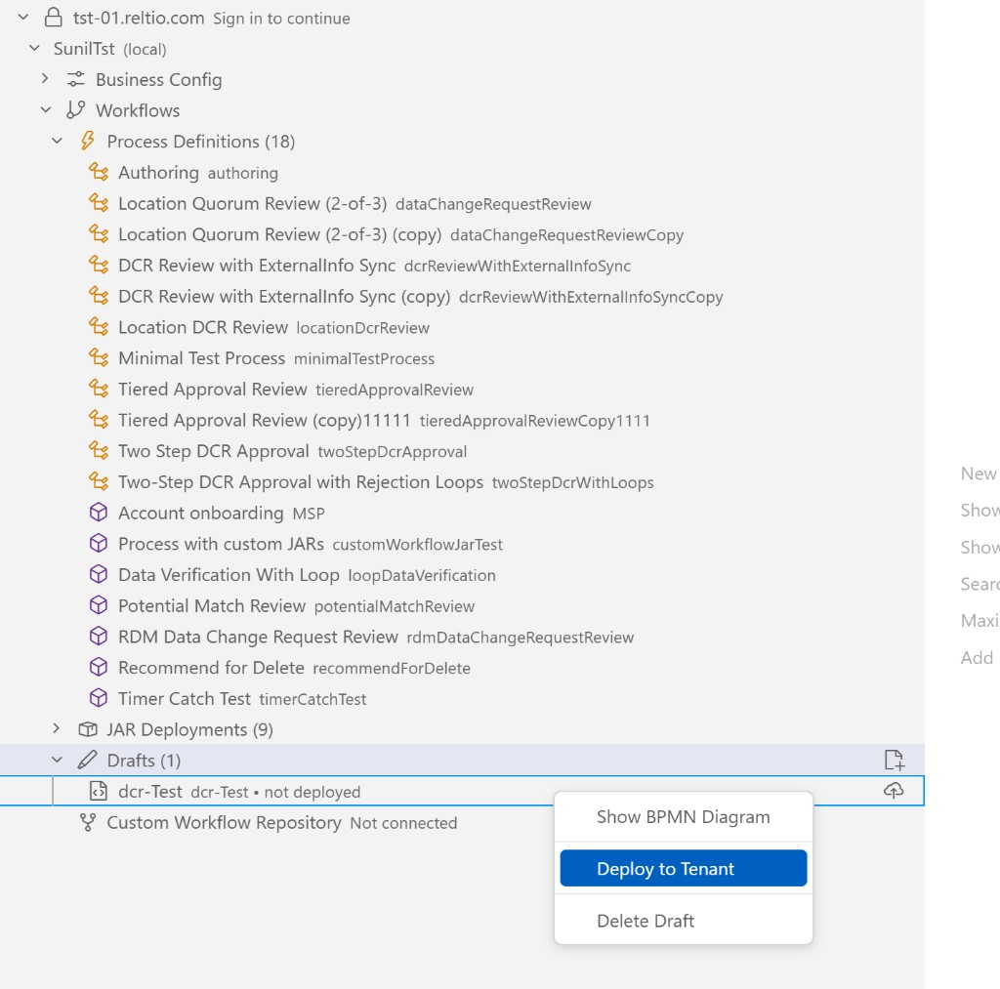
   
  <em>Screenshot: Deploy to Tenant on a workflow with local changes.</em>

---

### 3. Create a new workflow

You can start from a template or let the AI assistant build it.

**Start from a template**

1. Right-click **Process Definitions** and select **New Workflow...**. To start from an existing workflow instead, right-click it and select **Duplicate as Draft...**.
2. Give it an ID and a display name. The ID is its technical name on the tenant, so choose it carefully: using the ID of a workflow that already exists replaces that workflow when you deploy.
3. A starter process opens with a start, one review task and an end. Edit it to match your process.
4. Select **Show BPMN Diagram** to check it, then **Deploy to Tenant**.

Your new workflow appears in the list with a pencil icon and the word **draft** until you deploy it.

  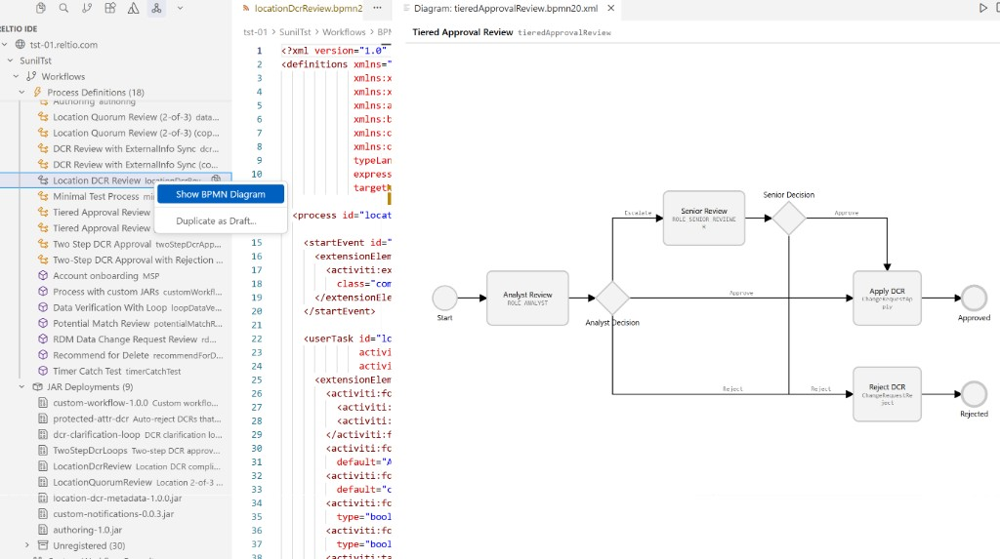
   
  <em>Screenshot: New Workflow... on Process Definitions.</em>

**Let the AI assistant build it**

Open your editor's AI assistant and describe what you need in plain language, for example:

> *Create an approval workflow for new Organization records. A data steward reviews each one, and if nobody responds in three days it goes to the team lead.*

The assistant writes the workflow as a draft in your list. It tells you the ID it used and what to do next.

  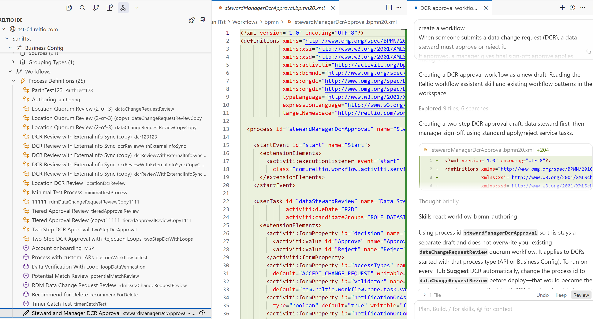
   
  <em>Screenshot: Describing a workflow to the AI assistant.</em>

If your request cannot be done without custom Java, the assistant stops and asks you to connect a repository first. It creates nothing until you have. The next step explains why.

---

### 4. Build a workflow that needs custom Java

Most workflows need no code. You need Java when a workflow must do something the standard building blocks cannot, such as a custom notification, a call to an outside system, or a rule about which records it applies to.

Java goes through your Custom Workflow Repository, the Git repository Reltio provisions for your tenant. Reltio reviews every change to it, so this path takes longer than step 2 or 3: expect hours at least, usually a business day or more.

1. **Connect your repository.** Right-click **Workflows** and select **Connect Custom Workflow Repository...** (details in [step 5](#5-keep-your-workflows-in-git)). **Java Classes** and **Java Tests** now appear under **Workflows**.
2. **Ask the AI assistant** for the workflow, exactly as in step 3. It now writes both parts together: the Java in your repository, and the workflow as a draft in **Process Definitions**, already pointing at the new Java class.
3. **Send it for review.** The assistant asks whether to raise a pull request. This is the one point where anything leaves your machine, so it always asks first. Reltio reviews it, and automatic checks run on it.
4. **Wait for the Java package.** When your pull request is approved, Reltio builds the package and tells you it is ready.
5. **Register it.** Right-click **JAR Deployments** and select **Refresh JARs**. The new package appears under **Unregistered JARs**. Right-click it and select **Register JAR...**.
6. **Deploy the workflow.** Right-click the draft and select **Deploy to Tenant**.

  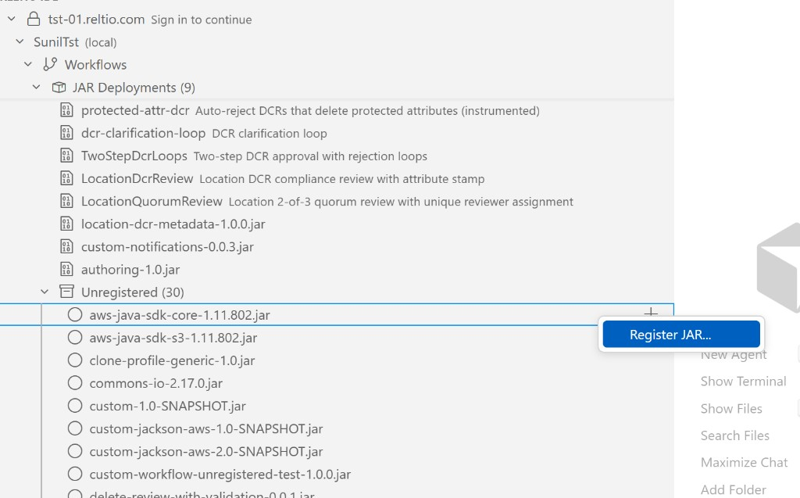
   
  <em>Screenshot: Refresh JARs, then Register JAR.</em>

  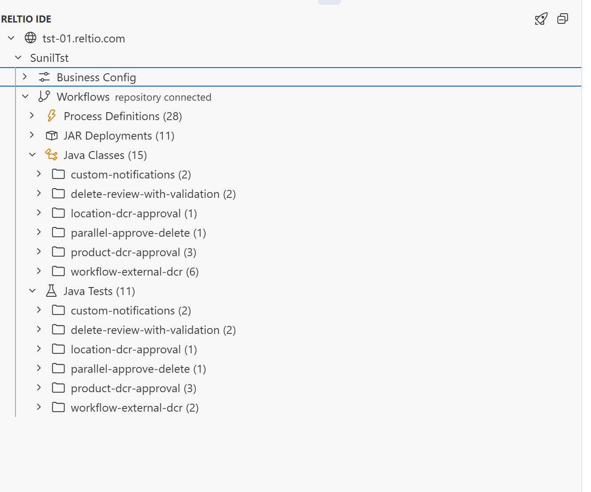
   
  <em>Screenshot: Java Classes and Java Tests, grouped by module.</em>

---

### 5. Keep your workflows in Git

Connect your Custom Workflow Repository when you want your workflows and Java in version control, or when you need Java at all (step 4).

**Connect**

1. Right-click **Workflows** and select **Connect Custom Workflow Repository...**. If you have not connected one, the same action also appears as a row under **Workflows**.
2. Paste the repository's address and press Enter.

  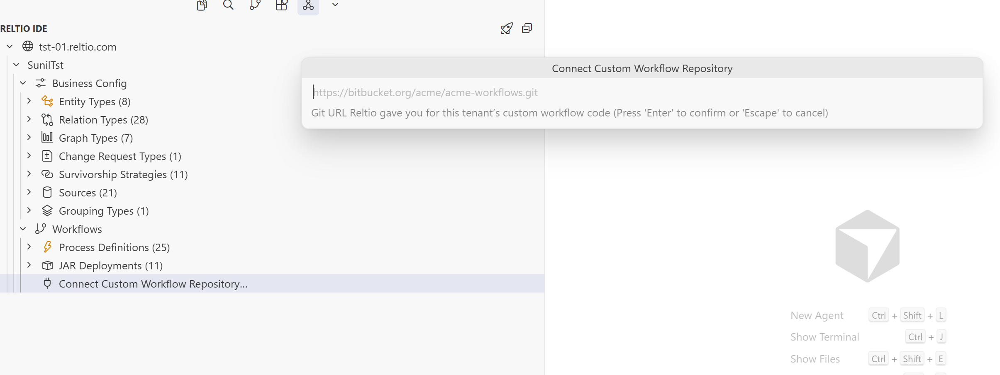
   
  <em>Screenshot: Connect Custom Workflow Repository.</em>

What happens to what you already have:

- **Your drafts** move into the repository's `bpmn` folder. They are included the next time you commit.
- **A draft with the same name as a workflow the repository already has:** your copy is kept, and Git shows it as changed.
- **Any other file with the same name as one in the repository:** nothing is changed. The message lists the files. Rename them and connect again.

  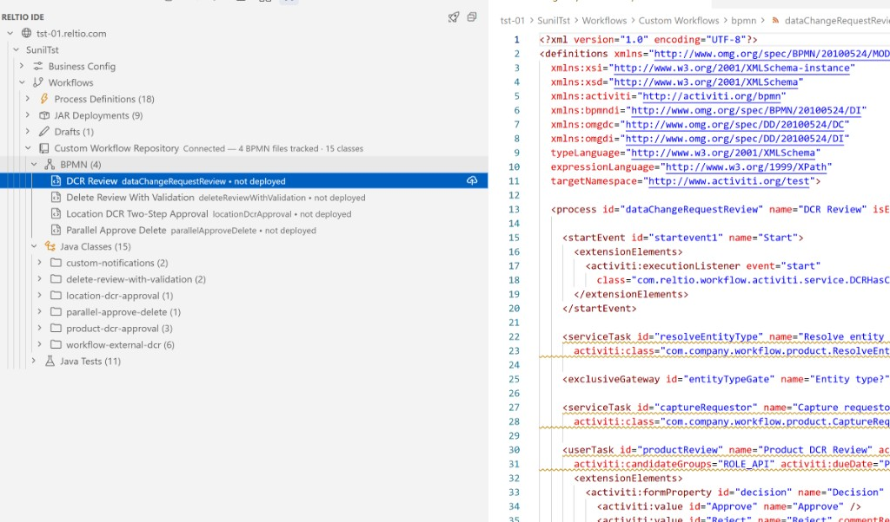
   
  <em>Screenshot: A connected repository.</em>

**Working with a connected repository**

- Workflows from your repository get their own rows with the repository icon, even when a workflow with the same ID is already deployed. Each row says how it compares with the tenant: **not deployed**, **differs from tenant**, **same as tenant**, or **deployed, not compared yet**.
- Select **Refresh Sync Status** on **Workflows** to update that comparison.
- Right-click **Workflows** and select **Open Repository Folder** or **Open Repository in Browser** to see the rest of the repository.
- The workflows you download from your tenant sit in the same folder as the repository's own. When you commit, choose the files you mean to share: copies of Reltio's own workflows do not belong in your repository.

**Disconnect**

Right-click **Workflows** and select **Disconnect Custom Workflow Repository**. A message tells you how many files will be removed and how many are kept before anything happens.

- **Removed:** the repository's files, including its Java, so you can connect a different repository afterwards.
- **Kept:** your drafts, the workflows downloaded from your tenant, files you added yourself, and any change you made but have not committed.
- **Push first** if you have commits that are not pushed: they are lost when you disconnect.

<!-- TODO screenshot: docs/images/disconnect-workflow-repository.png - the disconnect confirmation message -->

---

### 6. Quick reference

**Right-click actions**

| Where | Action | What it does |
|---|---|---|
| Workflows | Edit Workflow Adapter URL | Sets the address of your tenant's workflow service |
| Workflows | Connect / Disconnect Custom Workflow Repository | Links or unlinks your Git repository |
| Workflows | Refresh Sync Status | Compares the repository with your tenant |
| Process Definitions | New Workflow... | Creates a draft from a starter template |
| Process Definitions | Refresh BPMNs | Updates the list and your downloaded copies |
| A workflow | Duplicate as Draft... | Starts a new draft from an existing workflow |
| A workflow | Show BPMN Diagram | Shows it as a diagram |
| A workflow | Compare with Last Fetch / Discard Local Changes | Reviews or undoes your edits |
| A workflow | Deploy to Tenant | Publishes it to your tenant, after you confirm |
| JAR Deployments | Refresh JARs | Looks for newly published Java packages |
| An unregistered JAR | Register JAR... | Makes the package available to your workflows |

**Where your files are**

Inside your tenant's folder, under `Workflows/`:

- `bpmn/` — your workflows, one `.bpmn20.xml` file each. Next to each downloaded workflow is a small `.baseline.xml` file that Reltio IDE uses to spot your changes. Leave it alone: it is kept out of Git for you.
- With a repository connected, the repository's own folders sit beside `bpmn/`.

**Common questions**

- **Why is my new workflow not listed as a draft?** If you changed a workflow that was already in your repository, it is shown as a repository workflow, not a draft. Drafts are new files.
- **Why is there no Java Classes folder?** It appears once a repository is connected.
- **Why did the assistant create nothing?** Your request needs custom Java and no repository is connected. Connect one and ask again.
- **Why does a repository workflow say "deployed, not compared yet"?** The ID is on your tenant but the comparison has not run yet. Select **Refresh Sync Status**.

---

## Security and credential handling

- **Browser OAuth (recommended):** your Client ID, Client secret, and session are handled through single sign-on and stored in your operating system's secure credential store — never in a plaintext file.
- **Bearer token:** kept in memory only for the current session and cleared on restart. It is never written to `settings.json` or committed to your workspace.
- **Git repositories:** clone and private-repository access use Git on your machine and its credential helper. Reltio IDE never asks you to place a git password or token in workspace settings.
- Reltio IDE never asks you to place a token, client secret, or password directly in workspace settings.
- **LCA agent:** ask it for an environment-variable or credential-reference name. Do not paste a secret key, password, or token into the chat.

---

## Requirements

- VS Code or Cursor
- For tenant mode: a Reltio tenant and valid credentials (OAuth Client ID/Client secret + SSO routing tenant ID, or a bearer token), and permission to read and apply L3 configuration
- For repository mode: Git installed on your PATH, and access to clone if the repository is private.

---

*Copyright © 2026 Reltio, Inc. All rights reserved.*
